# Pastelki — free SVG pictures for little kids

**[pastelki.club](https://pastelki.club)** is a library of gentle, colourful SVG illustrations for children aged 2–6:
animals, food, vehicles, toys, the sea, space, feelings and more. Every picture is free for personal and commercial
use under the MIT license — for picture books, worksheets, colouring pages, apps, games and videos.

This repository is the downloadable copy of the whole library: every **approved, current** picture from pastelki.club
as an SVG file, plus a catalog with names in 17 languages. It is refreshed automatically from the site.

- Simple shapes, thick soft outlines, a calm pastel palette — nothing scary, loud or busy.
- Every picture is a square `viewBox="0 0 100 100"`: scale it to any size without losing quality.
- Small, clean SVG (no scripts, no external references, no embedded images) — a few kilobytes each.
- Moving parts carry stable ids (`pk-head`, `pk-eye-l`, `pk-leg-r`, `pk-tail`, …) so you can animate them.

## Download

| How | |
|---|---|
| **Everything as a ZIP** | Green **Code → Download ZIP** button on GitHub, or [download the ZIP from pastelki.club](https://pastelki.club/api/download/pastelki.zip) (SVGs only, same files) |
| **With git** | `git clone https://github.com/tobob/pastelki-assets.git` — then `git pull` for new pictures |
| **One picture** | Open it in the [gallery](gallery/README.md) and click *raw*, or use a link like `https://raw.githubusercontent.com/tobob/pastelki-assets/main/svg/zwierzeta/cat.svg` |
| **From a CDN** | `https://cdn.jsdelivr.net/gh/tobob/pastelki-assets@main/svg/<category>/<slug>.svg` |
| **On the website** | Browse, search, recolour and download single SVG/PNG files at [pastelki.club](https://pastelki.club) |

### What's inside

```
svg/<category>/<slug>.svg   the pictures (current approved version only)
catalog.json                every picture: names in 17 languages, category, tags, colour, version, links, sha256
catalog.csv                 the same as a spreadsheet
data/categories.json        category names in 17 languages
gallery/                    preview pages, one per category
scripts/sync.py             refreshes the repository from the public pastelki.club API
scripts/render-png.mjs      renders PNGs at any size
```

Languages in the catalog: `pl en de fr es it pt nl uk cs sk sv ro hu tr ja zh`. Tags (`tags_pl`) are in Polish.

<details>
<summary>An entry in <code>catalog.json</code></summary>

```json
{
  "slug": "buzka-psa",
  "title": { "pl": "buźka psa", "en": "Dog face", "de": "Hundegesicht", "…": "…" },
  "category": "buzki",
  "tags_pl": ["pies", "buźka", "zwierzę", "szczeniak", "oklapnięte uszy"],
  "color": "brown",
  "color_hex": "#9A6B4A",
  "version": 1,
  "updated_at": "2026-11-20T09:10:31.149740",
  "license": "MIT",
  "file": "svg/buzki/buzka-psa.svg",
  "bytes": 2187,
  "sha256": "…",
  "page_url": "https://pastelki.club/en/image/buzka-psa",
  "raw_url": "https://raw.githubusercontent.com/tobob/pastelki-assets/main/svg/buzki/buzka-psa.svg",
  "site_svg_url": "https://pastelki.club/files/buzka-psa/buzka-psa-v1.svg",
  "site_png_url": "https://pastelki.club/files/buzka-psa/buzka-psa-v1.png"
}
```

`version` grows when a picture is redrawn; the repository always holds the newest approved version.
`site_png_url` is a ready 512 × 512 PNG on pastelki.club.
</details>

## Using the pictures

- **Apps and websites:** use the SVG directly (``, `react-native-svg`, Android Vector Drawable
  import, Flutter `flutter_svg`, …). Read `catalog.json` to show the names in the child's language.
- **Print:** SVG is vector — it stays sharp at any size. Open it in Inkscape, Illustrator, Affinity, Figma, Canva or a
  browser and print, or render a large PNG (below).
- **Colouring pages:** the outlines are thick and closed. Remove the `fill` colours (or set them to white) in any
  vector editor, or use the colouring app [Kolorowanki](https://github.com/tobob/kolorowanki), which is built on these pictures.
- **Animation:** groups such as `pk-head`, `pk-arm-l`, `pk-leg-r`, `pk-tail` pivot naturally; `pk-shine-*` and
  `pk-shade-*` mark highlights and shading.
- **Recolouring and editing:** pastelki.club has an editor in the browser (open a picture → *Edit*).

### PNG files

PNGs are not stored in the repository (it stays small and diffs stay readable), but they are easy to make:

```bash
npm install
npm run png                  # png/512/<category>/<slug>.png
npm run png -- 256 1024      # several sizes
npm run png -- 1024 --bg=#ffffff
```

This uses [resvg](https://github.com/RazrFalcon/resvg) — the same renderer pastelki.club uses. Any SVG tool works too,
e.g. `rsvg-convert -w 512 cat.svg -o cat.png` or `inkscape cat.svg -w 512 -o cat.png`.

## License and attribution

The pictures are released under the [MIT license](LICENSE) — © 2026 Pastelki ([pastelki.club](https://pastelki.club)) —
with an **additional permission**:

- **Using a picture inside your own work** (a picture book, print, poster, worksheet, app, game, website, video,
  classroom material…), personal or commercial: you **don't** need to show the license or credit anyone.
- **Redistributing the files themselves** (for example as a downloadable asset pack, or on a stock site): include the
  [LICENSE](LICENSE) file, and please link back to the source, [pastelki.club](https://pastelki.club).
  Don't present the pictures as your own stock collection or claim exclusive rights to them.

You may edit, crop, combine and recolour them as much as you like. The pictures are provided "as is", without any
warranty. The name and logo "Pastelki" are not covered by the license. More in plain words:
[pastelki.club/en/license](https://pastelki.club/en/license).

The pictures are Pastelki's own work: they are written as SVG with the help of AI (the Claude model) following a strict
style guide, and a person checks and approves every picture before it is published. No third-party artwork is included.

## Made with these pictures

- **Kolorowanki** — a gentle colouring app for children 2–6: [github.com/tobob/kolorowanki](https://github.com/tobob/kolorowanki) · [pastelki.club/en/apps/kolorowanki](https://pastelki.club/en/apps/kolorowanki)
- **Pasujki** — a calm, offline matching game for children 2–5: [github.com/tobob/pasujki](https://github.com/tobob/pasujki) · [pastelki.club/en/apps/pasujki](https://pastelki.club/en/apps/pasujki)

## Feedback, problems, ideas for pictures

Found a mistake in a picture or a name, or would you like a picture that's missing?
Tell us at **[pastelki.club/en/feedback](https://pastelki.club/en/feedback?app=other)**, or
[open an issue](https://github.com/tobob/pastelki-assets/issues). Pictures are fixed on pastelki.club and reach this
repository with the next sync — see [CONTRIBUTING.md](CONTRIBUTING.md).

## How this repository is updated

[`scripts/sync.py`](scripts/sync.py) (Python standard library only) reads the public API
`https://pastelki.club/api/library`, which lists only approved pictures in their current version. It downloads the
SVGs, checks each one (valid XML, `viewBox 0 0 100 100`, no scripts or external references), removes pictures that are
no longer published, and regenerates `catalog.json`, `catalog.csv` and the gallery. A
[GitHub Action](.github/workflows/sync.yml) runs it every day and commits the changes after `npm run validate` has
rendered every SVG.

```bash
python3 scripts/sync.py           # refresh
python3 scripts/sync.py --check   # only report differences
```

## Gallery

<!-- gallery:start -->

**302 pictures in 18 categories.** Click a category for every picture with its name and download links.

**[Animals](gallery/zwierzeta.md)** · Zwierzęta · 57

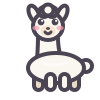 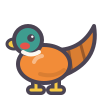 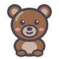 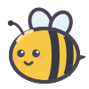 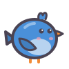 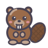 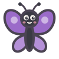 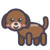

**[Baby animals](gallery/maluchy.md)** · Zwierzęce maluchy · 14

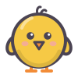 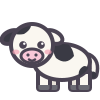 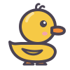 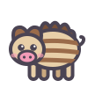 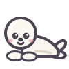 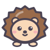 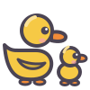 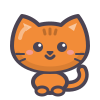

**[Animal faces](gallery/buzki.md)** · Zwierzęce buźki · 11

 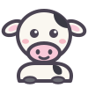 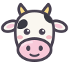 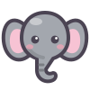 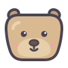 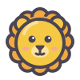  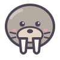

**[Food](gallery/jedzenie.md)** · Jedzenie · 33

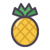 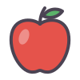 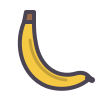 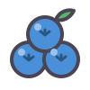 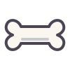 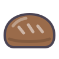 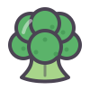 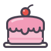

**[Nature & weather](gallery/natura.md)** · Natura i pogoda · 20

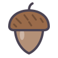 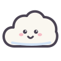 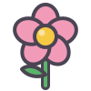 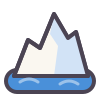 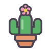 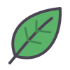 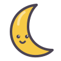 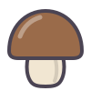

**[Houses & places](gallery/domki.md)** · Domki i miejsca · 12

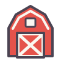 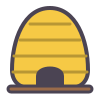 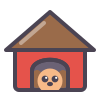   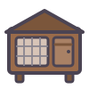  

**[Vehicles](gallery/pojazdy.md)** · Pojazdy · 14

  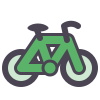  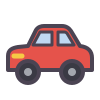  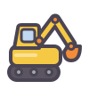 

**[Clothes](gallery/ubrania.md)** · Ubranka · 14

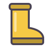  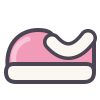  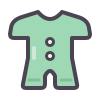   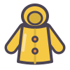

**[At home](gallery/dom.md)** · W domu · 18

   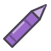    

**[Toys](gallery/zabawki.md)** · Zabawki · 19

       

**[Sea creatures](gallery/morze.md)** · Morskie stworzenia · 12

       

**[Bugs & insects](gallery/owady.md)** · Owady i robaczki · 12

       

**[Dinosaurs](gallery/dinozaury.md)** · Dinozaury · 7

      

**[Space](gallery/kosmos.md)** · Kosmos · 13

       

**[Music](gallery/muzyka.md)** · Muzyka · 12

       

**[Faces & feelings](gallery/emocje.md)** · Buzie i emocje · 11

       

**[Celebrations](gallery/swieta.md)** · Święta i przyjęcia · 10

       

**[Sports & play](gallery/sport.md)** · Sport i ruch · 13

       

<!-- gallery:end -->
