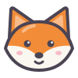
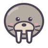

# Animal faces · Zwierzęce buźki

12 pictures · [all categories](README.md) · [back to the repository](../README.md)

<!-- generated by scripts/sync.py — do not edit by hand -->

| | | | |
|:-:|:-:|:-:|:-:|
|  **Dog face** Buźka psa `buzka-psa` · v1 · [raw](https://raw.githubusercontent.com/tobob/pastelki-assets/main/svg/buzki/buzka-psa.svg) · [site](https://pastelki.club/en/image/buzka-psa) |  **Calf** Cielątko `calf` · v2 · [raw](https://raw.githubusercontent.com/tobob/pastelki-assets/main/svg/buzki/calf.svg) · [site](https://pastelki.club/en/image/calf) |  **Cow** Krowa `cow` · v4 · [raw](https://raw.githubusercontent.com/tobob/pastelki-assets/main/svg/buzki/cow.svg) · [site](https://pastelki.club/en/image/cow) |  **Elephant** Słoń `elephant` · v4 · [raw](https://raw.githubusercontent.com/tobob/pastelki-assets/main/svg/buzki/elephant.svg) · [site](https://pastelki.club/en/image/elephant) |
|  **Capybara** Kapibara `kapibara` · v1 · [raw](https://raw.githubusercontent.com/tobob/pastelki-assets/main/svg/buzki/kapibara.svg) · [site](https://pastelki.club/en/image/kapibara) |  **Lion** Lew `lion` · v4 · [raw](https://raw.githubusercontent.com/tobob/pastelki-assets/main/svg/buzki/lion.svg) · [site](https://pastelki.club/en/image/lion) |  **Little fox** Lisek na spacerze `lisek-na-spacerze` · v1 · [raw](https://raw.githubusercontent.com/tobob/pastelki-assets/main/svg/buzki/lisek-na-spacerze.svg) · [site](https://pastelki.club/en/image/lisek-na-spacerze) |  **Monkey** Małpka `monkey` · v4 · [raw](https://raw.githubusercontent.com/tobob/pastelki-assets/main/svg/buzki/monkey.svg) · [site](https://pastelki.club/en/image/monkey) |
|  **Walrus** Mors `mors` · v3 · [raw](https://raw.githubusercontent.com/tobob/pastelki-assets/main/svg/buzki/mors.svg) · [site](https://pastelki.club/en/image/mors) |  **Penguin** Pingwin `pingwin` · v1 · [raw](https://raw.githubusercontent.com/tobob/pastelki-assets/main/svg/buzki/pingwin.svg) · [site](https://pastelki.club/en/image/pingwin) |  **Tiger** Tygrys `tiger` · v4 · [raw](https://raw.githubusercontent.com/tobob/pastelki-assets/main/svg/buzki/tiger.svg) · [site](https://pastelki.club/en/image/tiger) |  **Zebra** Zebra `zebra` · v2 · [raw](https://raw.githubusercontent.com/tobob/pastelki-assets/main/svg/buzki/zebra.svg) · [site](https://pastelki.club/en/image/zebra) |
