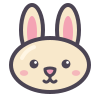
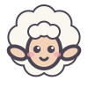
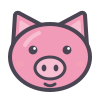
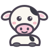
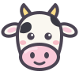
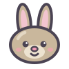
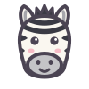

# Animal faces · Zwierzęce buźki

24 pictures · [all categories](README.md) · [back to the repository](../README.md)

<!-- generated by scripts/sync.py — do not edit by hand -->

| | | | |
|:-:|:-:|:-:|:-:|
|  **Cat face** Buźka kota `buzka-kota` · v1 · [raw](https://raw.githubusercontent.com/tobob/pastelki-assets/main/svg/buzki/buzka-kota.svg) · [site](https://pastelki.club/en/image/buzka-kota?utm_source=github&utm_medium=gallery&utm_campaign=pastelki-assets) |  **Rabbit face** Buźka królika `buzka-krolika` · v1 · [raw](https://raw.githubusercontent.com/tobob/pastelki-assets/main/svg/buzki/buzka-krolika.svg) · [site](https://pastelki.club/en/image/buzka-krolika?utm_source=github&utm_medium=gallery&utm_campaign=pastelki-assets) |  **Bear face** Buźka misia `buzka-misia` · v1 · [raw](https://raw.githubusercontent.com/tobob/pastelki-assets/main/svg/buzki/buzka-misia.svg) · [site](https://pastelki.club/en/image/buzka-misia?utm_source=github&utm_medium=gallery&utm_campaign=pastelki-assets) |  **Sheep face** Buźka owieczki `buzka-owieczki` · v1 · [raw](https://raw.githubusercontent.com/tobob/pastelki-assets/main/svg/buzki/buzka-owieczki.svg) · [site](https://pastelki.club/en/image/buzka-owieczki?utm_source=github&utm_medium=gallery&utm_campaign=pastelki-assets) |
|  **Panda face** Buźka pandy `buzka-pandy` · v1 · [raw](https://raw.githubusercontent.com/tobob/pastelki-assets/main/svg/buzki/buzka-pandy.svg) · [site](https://pastelki.club/en/image/buzka-pandy?utm_source=github&utm_medium=gallery&utm_campaign=pastelki-assets) |  **Dog face** Buźka psa `buzka-psa` · v1 · [raw](https://raw.githubusercontent.com/tobob/pastelki-assets/main/svg/buzki/buzka-psa.svg) · [site](https://pastelki.club/en/image/buzka-psa?utm_source=github&utm_medium=gallery&utm_campaign=pastelki-assets) |  **Elephant face** Buźka słonia `buzka-slonia` · v1 · [raw](https://raw.githubusercontent.com/tobob/pastelki-assets/main/svg/buzki/buzka-slonia.svg) · [site](https://pastelki.club/en/image/buzka-slonia?utm_source=github&utm_medium=gallery&utm_campaign=pastelki-assets) |  **Pig face** Buźka świnki `buzka-swinki` · v1 · [raw](https://raw.githubusercontent.com/tobob/pastelki-assets/main/svg/buzki/buzka-swinki.svg) · [site](https://pastelki.club/en/image/buzka-swinki?utm_source=github&utm_medium=gallery&utm_campaign=pastelki-assets) |
|  **Tiger cub face** Buźka tygrysiątka `buzka-tygrysiatka` · v1 · [raw](https://raw.githubusercontent.com/tobob/pastelki-assets/main/svg/buzki/buzka-tygrysiatka.svg) · [site](https://pastelki.club/en/image/buzka-tygrysiatka?utm_source=github&utm_medium=gallery&utm_campaign=pastelki-assets) |  **Frog face** Buźka żaby `buzka-zaby` · v1 · [raw](https://raw.githubusercontent.com/tobob/pastelki-assets/main/svg/buzki/buzka-zaby.svg) · [site](https://pastelki.club/en/image/buzka-zaby?utm_source=github&utm_medium=gallery&utm_campaign=pastelki-assets) |  **Calf** Cielątko `calf` · v2 · [raw](https://raw.githubusercontent.com/tobob/pastelki-assets/main/svg/buzki/calf.svg) · [site](https://pastelki.club/en/image/calf?utm_source=github&utm_medium=gallery&utm_campaign=pastelki-assets) |  **Cow** Krowa `cow` · v4 · [raw](https://raw.githubusercontent.com/tobob/pastelki-assets/main/svg/buzki/cow.svg) · [site](https://pastelki.club/en/image/cow?utm_source=github&utm_medium=gallery&utm_campaign=pastelki-assets) |
|  **Elephant** Słoń `elephant` · v4 · [raw](https://raw.githubusercontent.com/tobob/pastelki-assets/main/svg/buzki/elephant.svg) · [site](https://pastelki.club/en/image/elephant?utm_source=github&utm_medium=gallery&utm_campaign=pastelki-assets) |  **Capybara** Kapibara `kapibara` · v2 · [raw](https://raw.githubusercontent.com/tobob/pastelki-assets/main/svg/buzki/kapibara.svg) · [site](https://pastelki.club/en/image/kapibara?utm_source=github&utm_medium=gallery&utm_campaign=pastelki-assets) |  **Lion** Lew `lion` · v4 · [raw](https://raw.githubusercontent.com/tobob/pastelki-assets/main/svg/buzki/lion.svg) · [site](https://pastelki.club/en/image/lion?utm_source=github&utm_medium=gallery&utm_campaign=pastelki-assets) |  **Fox face** Buźka lisa `lisek-na-spacerze` · v2 · [raw](https://raw.githubusercontent.com/tobob/pastelki-assets/main/svg/buzki/lisek-na-spacerze.svg) · [site](https://pastelki.club/en/image/lisek-na-spacerze?utm_source=github&utm_medium=gallery&utm_campaign=pastelki-assets) |
|  **Monkey** Małpka `monkey` · v4 · [raw](https://raw.githubusercontent.com/tobob/pastelki-assets/main/svg/buzki/monkey.svg) · [site](https://pastelki.club/en/image/monkey?utm_source=github&utm_medium=gallery&utm_campaign=pastelki-assets) |  **Walrus** Mors `mors` · v3 · [raw](https://raw.githubusercontent.com/tobob/pastelki-assets/main/svg/buzki/mors.svg) · [site](https://pastelki.club/en/image/mors?utm_source=github&utm_medium=gallery&utm_campaign=pastelki-assets) |  **Penguin** Pingwin `pingwin` · v1 · [raw](https://raw.githubusercontent.com/tobob/pastelki-assets/main/svg/buzki/pingwin.svg) · [site](https://pastelki.club/en/image/pingwin?utm_source=github&utm_medium=gallery&utm_campaign=pastelki-assets) |  **Owl** Sowa buźka `sowa-buzka` · v1 · [raw](https://raw.githubusercontent.com/tobob/pastelki-assets/main/svg/buzki/sowa-buzka.svg) · [site](https://pastelki.club/en/image/sowa-buzka?utm_source=github&utm_medium=gallery&utm_campaign=pastelki-assets) |
|  **Tiger** Tygrys `tiger` · v4 · [raw](https://raw.githubusercontent.com/tobob/pastelki-assets/main/svg/buzki/tiger.svg) · [site](https://pastelki.club/en/image/tiger?utm_source=github&utm_medium=gallery&utm_campaign=pastelki-assets) |  **Hare** Zając buźka `zajac-buzka` · v1 · [raw](https://raw.githubusercontent.com/tobob/pastelki-assets/main/svg/buzki/zajac-buzka.svg) · [site](https://pastelki.club/en/image/zajac-buzka?utm_source=github&utm_medium=gallery&utm_campaign=pastelki-assets) |  **Zebra** Zebra `zebra` · v2 · [raw](https://raw.githubusercontent.com/tobob/pastelki-assets/main/svg/buzki/zebra.svg) · [site](https://pastelki.club/en/image/zebra?utm_source=github&utm_medium=gallery&utm_campaign=pastelki-assets) |  **Giraffe** Żyrafa buźka `zyrafa-buzka` · v1 · [raw](https://raw.githubusercontent.com/tobob/pastelki-assets/main/svg/buzki/zyrafa-buzka.svg) · [site](https://pastelki.club/en/image/zyrafa-buzka?utm_source=github&utm_medium=gallery&utm_campaign=pastelki-assets) |
