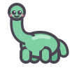
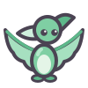
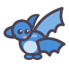
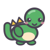
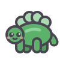
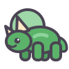
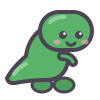

# Dinosaurs · Dinozaury

10 pictures · [all categories](README.md) · [back to the repository](../README.md)

<!-- generated by scripts/sync.py — do not edit by hand -->

| | | | |
|:-:|:-:|:-:|:-:|
|  **Little ankylosaurus** Ankylozaur `ankylozaur` · v1 · [raw](https://raw.githubusercontent.com/tobob/pastelki-assets/main/svg/dinozaury/ankylozaur.svg) · [site](https://pastelki.club/en/image/ankylozaur) |  **Long-neck dinosaur** Dinozaur z długą szyją `dinozaur-z-dluga-szyja` · v3 · [raw](https://raw.githubusercontent.com/tobob/pastelki-assets/main/svg/dinozaury/dinozaur-z-dluga-szyja.svg) · [site](https://pastelki.club/en/image/dinozaur-z-dluga-szyja) |  **Dinosaur egg** Jajko dinozaura `jajko-dinozaura` · v3 · [raw](https://raw.githubusercontent.com/tobob/pastelki-assets/main/svg/dinozaury/jajko-dinozaura.svg) · [site](https://pastelki.club/en/image/jajko-dinozaura) |  **Little pterodactyl** Mały pterodaktyl `maly-pterodaktyl` · v3 · [raw](https://raw.githubusercontent.com/tobob/pastelki-assets/main/svg/dinozaury/maly-pterodaktyl.svg) · [site](https://pastelki.club/en/image/maly-pterodaktyl) |
|  **Pterodactyl** Pterodaktyl `pterodaktyl` · v1 · [raw](https://raw.githubusercontent.com/tobob/pastelki-assets/main/svg/dinozaury/pterodaktyl.svg) · [site](https://pastelki.club/en/image/pterodaktyl) |  **Dragon** Smok `smok` · v4 · [raw](https://raw.githubusercontent.com/tobob/pastelki-assets/main/svg/dinozaury/smok.svg) · [site](https://pastelki.club/en/image/smok) |  **Stegosaurus** Stegozaur `smok-latawiec` · v4 · [raw](https://raw.githubusercontent.com/tobob/pastelki-assets/main/svg/dinozaury/smok-latawiec.svg) · [site](https://pastelki.club/en/image/smok-latawiec) |  **Stegosaurus** Stegozaur `stegozaur` · v2 · [raw](https://raw.githubusercontent.com/tobob/pastelki-assets/main/svg/dinozaury/stegozaur.svg) · [site](https://pastelki.club/en/image/stegozaur) |
|  **Triceratops** Triceratops `triceratops` · v4 · [raw](https://raw.githubusercontent.com/tobob/pastelki-assets/main/svg/dinozaury/triceratops.svg) · [site](https://pastelki.club/en/image/triceratops) |  **Friendly T-rex** Tyranozaur `tyranozaur` · v4 · [raw](https://raw.githubusercontent.com/tobob/pastelki-assets/main/svg/dinozaury/tyranozaur.svg) · [site](https://pastelki.club/en/image/tyranozaur) |  |  |
