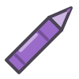
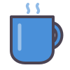
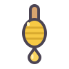
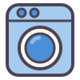
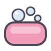
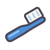

# At home · W domu

19 pictures · [all categories](README.md) · [back to the repository](../README.md)

<!-- generated by scripts/sync.py — do not edit by hand -->

| | | | |
|:-:|:-:|:-:|:-:|
|  **Bed** Łóżko `bed` · v1 · [raw](https://raw.githubusercontent.com/tobob/pastelki-assets/main/svg/dom/bed.svg) · [site](https://pastelki.club/en/image/bed) |  **Book** Książka `book` · v1 · [raw](https://raw.githubusercontent.com/tobob/pastelki-assets/main/svg/dom/book.svg) · [site](https://pastelki.club/en/image/book) |  **Clock** Zegar `clock` · v1 · [raw](https://raw.githubusercontent.com/tobob/pastelki-assets/main/svg/dom/clock.svg) · [site](https://pastelki.club/en/image/clock) |  **Crayon** Kredka `crayon` · v1 · [raw](https://raw.githubusercontent.com/tobob/pastelki-assets/main/svg/dom/crayon.svg) · [site](https://pastelki.club/en/image/crayon) |
|  **Cup** Kubek `cup` · v1 · [raw](https://raw.githubusercontent.com/tobob/pastelki-assets/main/svg/dom/cup.svg) · [site](https://pastelki.club/en/image/cup) |  **Capybara in the bath** Kapibara w kąpieli `kapibara-w-kapieli` · v2 · [raw](https://raw.githubusercontent.com/tobob/pastelki-assets/main/svg/dom/kapibara-w-kapieli.svg) · [site](https://pastelki.club/en/image/kapibara-w-kapieli) |  **Key** Klucz `key` · v3 · [raw](https://raw.githubusercontent.com/tobob/pastelki-assets/main/svg/dom/key.svg) · [site](https://pastelki.club/en/image/key) |  **Basket** Koszyk `koszyk` · v1 · [raw](https://raw.githubusercontent.com/tobob/pastelki-assets/main/svg/dom/koszyk.svg) · [site](https://pastelki.club/en/image/koszyk) |
|  **Honey dipper** Kropla miodu na łyżeczce `kropla-miodu-na-lyzeczce` · v1 · [raw](https://raw.githubusercontent.com/tobob/pastelki-assets/main/svg/dom/kropla-miodu-na-lyzeczce.svg) · [site](https://pastelki.club/en/image/kropla-miodu-na-lyzeczce) |  **Lamp** Lampka `lamp` · v1 · [raw](https://raw.githubusercontent.com/tobob/pastelki-assets/main/svg/dom/lamp.svg) · [site](https://pastelki.club/en/image/lamp) |  **Potty** Nocnik `nocnik` · v3 · [raw](https://raw.githubusercontent.com/tobob/pastelki-assets/main/svg/dom/nocnik.svg) · [site](https://pastelki.club/en/image/nocnik) |  **Scissors** Nożyczki `nozyczki` · v1 · [raw](https://raw.githubusercontent.com/tobob/pastelki-assets/main/svg/dom/nozyczki.svg) · [site](https://pastelki.club/en/image/nozyczki) |
|  **Pillow** Poduszka `pillow` · v3 · [raw](https://raw.githubusercontent.com/tobob/pastelki-assets/main/svg/dom/pillow.svg) · [site](https://pastelki.club/en/image/pillow) |  **Washing machine** Pralka `pralka` · v3 · [raw](https://raw.githubusercontent.com/tobob/pastelki-assets/main/svg/dom/pralka.svg) · [site](https://pastelki.club/en/image/pralka) |  **Little dragon** Smoczek `smoczek` · v1 · [raw](https://raw.githubusercontent.com/tobob/pastelki-assets/main/svg/dom/smoczek.svg) · [site](https://pastelki.club/en/image/smoczek) |  **Soap** Mydło `soap` · v3 · [raw](https://raw.githubusercontent.com/tobob/pastelki-assets/main/svg/dom/soap.svg) · [site](https://pastelki.club/en/image/soap) |
|  **Spoon** Łyżka `spoon` · v1 · [raw](https://raw.githubusercontent.com/tobob/pastelki-assets/main/svg/dom/spoon.svg) · [site](https://pastelki.club/en/image/spoon) |  **Toothbrush** Szczoteczka do zębów `toothbrush` · v2 · [raw](https://raw.githubusercontent.com/tobob/pastelki-assets/main/svg/dom/toothbrush.svg) · [site](https://pastelki.club/en/image/toothbrush) |  **Umbrella** Parasol `umbrella` · v3 · [raw](https://raw.githubusercontent.com/tobob/pastelki-assets/main/svg/dom/umbrella.svg) · [site](https://pastelki.club/en/image/umbrella) |  |
