# At home · W domu

29 pictures · [all categories](README.md) · [back to the repository](../README.md)

<!-- generated by scripts/sync.py — do not edit by hand -->

| | | | |
|:-:|:-:|:-:|:-:|
|  **Bed** Łóżko `bed` · v1 · [raw](https://raw.githubusercontent.com/tobob/pastelki-assets/main/svg/dom/bed.svg) · [site](https://pastelki.club/en/image/bed?utm_source=github&utm_medium=gallery&utm_campaign=pastelki-assets) |  **Book** Książka `book` · v1 · [raw](https://raw.githubusercontent.com/tobob/pastelki-assets/main/svg/dom/book.svg) · [site](https://pastelki.club/en/image/book?utm_source=github&utm_medium=gallery&utm_campaign=pastelki-assets) |  **Tissue** Chusteczka `chusteczka` · v1 · [raw](https://raw.githubusercontent.com/tobob/pastelki-assets/main/svg/dom/chusteczka.svg) · [site](https://pastelki.club/en/image/chusteczka?utm_source=github&utm_medium=gallery&utm_campaign=pastelki-assets) |  **Clock** Zegar `clock` · v1 · [raw](https://raw.githubusercontent.com/tobob/pastelki-assets/main/svg/dom/clock.svg) · [site](https://pastelki.club/en/image/clock?utm_source=github&utm_medium=gallery&utm_campaign=pastelki-assets) |
|  **Crayon** Kredka `crayon` · v1 · [raw](https://raw.githubusercontent.com/tobob/pastelki-assets/main/svg/dom/crayon.svg) · [site](https://pastelki.club/en/image/crayon?utm_source=github&utm_medium=gallery&utm_campaign=pastelki-assets) |  **Cup** Kubek `cup` · v1 · [raw](https://raw.githubusercontent.com/tobob/pastelki-assets/main/svg/dom/cup.svg) · [site](https://pastelki.club/en/image/cup?utm_source=github&utm_medium=gallery&utm_campaign=pastelki-assets) | <a href="../svg/dom/kalamarz-z-piorkiem.svg">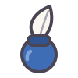</a> **Inkwell with a feather** Kałamarz z piórkiem `kalamarz-z-piorkiem` · v1 · [raw](https://raw.githubusercontent.com/tobob/pastelki-assets/main/svg/dom/kalamarz-z-piorkiem.svg) · [site](https://pastelki.club/en/image/kalamarz-z-piorkiem?utm_source=github&utm_medium=gallery&utm_campaign=pastelki-assets) | <a href="../svg/dom/kapibara-w-kapieli.svg">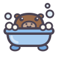</a> **Capybara in the bath** Kapibara w kąpieli `kapibara-w-kapieli` · v3 · [raw](https://raw.githubusercontent.com/tobob/pastelki-assets/main/svg/dom/kapibara-w-kapieli.svg) · [site](https://pastelki.club/en/image/kapibara-w-kapieli?utm_source=github&utm_medium=gallery&utm_campaign=pastelki-assets) |
|  **Key** Klucz `key` · v3 · [raw](https://raw.githubusercontent.com/tobob/pastelki-assets/main/svg/dom/key.svg) · [site](https://pastelki.club/en/image/key?utm_source=github&utm_medium=gallery&utm_campaign=pastelki-assets) | <a href="../svg/dom/koc-piknikowy.svg">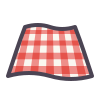</a> **Picnic blanket** Koc piknikowy `koc-piknikowy` · v1 · [raw](https://raw.githubusercontent.com/tobob/pastelki-assets/main/svg/dom/koc-piknikowy.svg) · [site](https://pastelki.club/en/image/koc-piknikowy?utm_source=github&utm_medium=gallery&utm_campaign=pastelki-assets) | <a href="../svg/dom/koszyk.svg">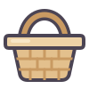</a> **Basket** Koszyk `koszyk` · v1 · [raw](https://raw.githubusercontent.com/tobob/pastelki-assets/main/svg/dom/koszyk.svg) · [site](https://pastelki.club/en/image/koszyk?utm_source=github&utm_medium=gallery&utm_campaign=pastelki-assets) |  **Honey dipper** Kropla miodu na łyżeczce `kropla-miodu-na-lyzeczce` · v1 · [raw](https://raw.githubusercontent.com/tobob/pastelki-assets/main/svg/dom/kropla-miodu-na-lyzeczce.svg) · [site](https://pastelki.club/en/image/kropla-miodu-na-lyzeczce?utm_source=github&utm_medium=gallery&utm_campaign=pastelki-assets) |
| <a href="../svg/dom/krzeslo.svg">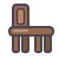</a> **Chair** Krzesło `krzeslo` · v1 · [raw](https://raw.githubusercontent.com/tobob/pastelki-assets/main/svg/dom/krzeslo.svg) · [site](https://pastelki.club/en/image/krzeslo?utm_source=github&utm_medium=gallery&utm_campaign=pastelki-assets) | <a href="../svg/dom/kurek-na-wietrze.svg">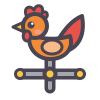</a> **Weathercock** Kurek na wietrze `kurek-na-wietrze` · v2 · [raw](https://raw.githubusercontent.com/tobob/pastelki-assets/main/svg/dom/kurek-na-wietrze.svg) · [site](https://pastelki.club/en/image/kurek-na-wietrze?utm_source=github&utm_medium=gallery&utm_campaign=pastelki-assets) |  **Lamp** Lampka `lamp` · v1 · [raw](https://raw.githubusercontent.com/tobob/pastelki-assets/main/svg/dom/lamp.svg) · [site](https://pastelki.club/en/image/lamp?utm_source=github&utm_medium=gallery&utm_campaign=pastelki-assets) | <a href="../svg/dom/nocnik.svg">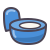</a> **Potty** Nocnik `nocnik` · v3 · [raw](https://raw.githubusercontent.com/tobob/pastelki-assets/main/svg/dom/nocnik.svg) · [site](https://pastelki.club/en/image/nocnik?utm_source=github&utm_medium=gallery&utm_campaign=pastelki-assets) |
| <a href="../svg/dom/nozyczki.svg">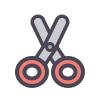</a> **Scissors** Nożyczki `nozyczki` · v1 · [raw](https://raw.githubusercontent.com/tobob/pastelki-assets/main/svg/dom/nozyczki.svg) · [site](https://pastelki.club/en/image/nozyczki?utm_source=github&utm_medium=gallery&utm_campaign=pastelki-assets) |  **Pillow** Poduszka `pillow` · v3 · [raw](https://raw.githubusercontent.com/tobob/pastelki-assets/main/svg/dom/pillow.svg) · [site](https://pastelki.club/en/image/pillow?utm_source=github&utm_medium=gallery&utm_campaign=pastelki-assets) |  **Washing machine** Pralka `pralka` · v3 · [raw](https://raw.githubusercontent.com/tobob/pastelki-assets/main/svg/dom/pralka.svg) · [site](https://pastelki.club/en/image/pralka?utm_source=github&utm_medium=gallery&utm_campaign=pastelki-assets) | <a href="../svg/dom/pranie-na-sznurku.svg">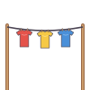</a> **Laundry on a line** Pranie na sznurku `pranie-na-sznurku` · v1 · [raw](https://raw.githubusercontent.com/tobob/pastelki-assets/main/svg/dom/pranie-na-sznurku.svg) · [site](https://pastelki.club/en/image/pranie-na-sznurku?utm_source=github&utm_medium=gallery&utm_campaign=pastelki-assets) |
| <a href="../svg/dom/rolka-papieru-toaletowego.svg">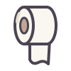</a> **Toilet paper roll** Rolka papieru toaletowego `rolka-papieru-toaletowego` · v1 · [raw](https://raw.githubusercontent.com/tobob/pastelki-assets/main/svg/dom/rolka-papieru-toaletowego.svg) · [site](https://pastelki.club/en/image/rolka-papieru-toaletowego?utm_source=github&utm_medium=gallery&utm_campaign=pastelki-assets) |  **Soap** Mydło `soap` · v3 · [raw](https://raw.githubusercontent.com/tobob/pastelki-assets/main/svg/dom/soap.svg) · [site](https://pastelki.club/en/image/soap?utm_source=github&utm_medium=gallery&utm_campaign=pastelki-assets) | <a href="../svg/dom/spoon.svg">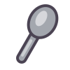</a> **Spoon** Łyżka `spoon` · v1 · [raw](https://raw.githubusercontent.com/tobob/pastelki-assets/main/svg/dom/spoon.svg) · [site](https://pastelki.club/en/image/spoon?utm_source=github&utm_medium=gallery&utm_campaign=pastelki-assets) |  **Table** Stół `stol` · v1 · [raw](https://raw.githubusercontent.com/tobob/pastelki-assets/main/svg/dom/stol.svg) · [site](https://pastelki.club/en/image/stol?utm_source=github&utm_medium=gallery&utm_campaign=pastelki-assets) |
| <a href="../svg/dom/szczoteczka-do-wlosow.svg">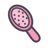</a> **Hairbrush** Szczoteczka do włosów `szczoteczka-do-wlosow` · v4 · [raw](https://raw.githubusercontent.com/tobob/pastelki-assets/main/svg/dom/szczoteczka-do-wlosow.svg) · [site](https://pastelki.club/en/image/szczoteczka-do-wlosow?utm_source=github&utm_medium=gallery&utm_campaign=pastelki-assets) |  **Glass of water** Szklanka `szklanka` · v1 · [raw](https://raw.githubusercontent.com/tobob/pastelki-assets/main/svg/dom/szklanka.svg) · [site](https://pastelki.club/en/image/szklanka?utm_source=github&utm_medium=gallery&utm_campaign=pastelki-assets) |  **Toothbrush** Szczoteczka do zębów `toothbrush` · v2 · [raw](https://raw.githubusercontent.com/tobob/pastelki-assets/main/svg/dom/toothbrush.svg) · [site](https://pastelki.club/en/image/toothbrush?utm_source=github&utm_medium=gallery&utm_campaign=pastelki-assets) | <a href="../svg/dom/umbrella.svg">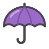</a> **Umbrella** Parasol `umbrella` · v3 · [raw](https://raw.githubusercontent.com/tobob/pastelki-assets/main/svg/dom/umbrella.svg) · [site](https://pastelki.club/en/image/umbrella?utm_source=github&utm_medium=gallery&utm_campaign=pastelki-assets) |
|  **Suitcase** Walizka `walizka` · v1 · [raw](https://raw.githubusercontent.com/tobob/pastelki-assets/main/svg/dom/walizka.svg) · [site](https://pastelki.club/en/image/walizka?utm_source=github&utm_medium=gallery&utm_campaign=pastelki-assets) |  |  |  |
