# Houses & places · Domki i miejsca

22 pictures · [all categories](README.md) · [back to the repository](../README.md)

<!-- generated by scripts/sync.py — do not edit by hand -->

| | | | |
|:-:|:-:|:-:|:-:|
| <a href="../svg/domki/barn.svg">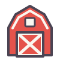</a> **Barn** Stodoła `barn` · v1 · [raw](https://raw.githubusercontent.com/tobob/pastelki-assets/main/svg/domki/barn.svg) · [site](https://pastelki.club/en/image/barn?utm_source=github&utm_medium=gallery&utm_campaign=pastelki-assets) | <a href="../svg/domki/beehive.svg">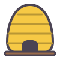</a> **Beehive** Ul `beehive` · v1 · [raw](https://raw.githubusercontent.com/tobob/pastelki-assets/main/svg/domki/beehive.svg) · [site](https://pastelki.club/en/image/beehive?utm_source=github&utm_medium=gallery&utm_campaign=pastelki-assets) |  **Doghouse** Buda `doghouse` · v3 · [raw](https://raw.githubusercontent.com/tobob/pastelki-assets/main/svg/domki/doghouse.svg) · [site](https://pastelki.club/en/image/doghouse?utm_source=github&utm_medium=gallery&utm_campaign=pastelki-assets) | <a href="../svg/domki/domek-dla-ptakow.svg">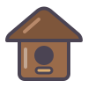</a> **Birdhouse** Domek dla ptaków `domek-dla-ptakow` · v1 · [raw](https://raw.githubusercontent.com/tobob/pastelki-assets/main/svg/domki/domek-dla-ptakow.svg) · [site](https://pastelki.club/en/image/domek-dla-ptakow?utm_source=github&utm_medium=gallery&utm_campaign=pastelki-assets) |
| <a href="../svg/domki/domek-na-drzewie.svg">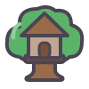</a> **Treehouse** Domek na drzewie `domek-na-drzewie` · v1 · [raw](https://raw.githubusercontent.com/tobob/pastelki-assets/main/svg/domki/domek-na-drzewie.svg) · [site](https://pastelki.club/en/image/domek-na-drzewie?utm_source=github&utm_medium=gallery&utm_campaign=pastelki-assets) | <a href="../svg/domki/house.svg">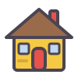</a> **House** Domek `house` · v1 · [raw](https://raw.githubusercontent.com/tobob/pastelki-assets/main/svg/domki/house.svg) · [site](https://pastelki.club/en/image/house?utm_source=github&utm_medium=gallery&utm_campaign=pastelki-assets) | <a href="../svg/domki/hutch.svg">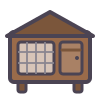</a> **Rabbit hutch** Klatka królika `hutch` · v1 · [raw](https://raw.githubusercontent.com/tobob/pastelki-assets/main/svg/domki/hutch.svg) · [site](https://pastelki.club/en/image/hutch?utm_source=github&utm_medium=gallery&utm_campaign=pastelki-assets) |  **Pet bowl** Miska `kennel-bowl` · v5 · [raw](https://raw.githubusercontent.com/tobob/pastelki-assets/main/svg/domki/kennel-bowl.svg) · [site](https://pastelki.club/en/image/kennel-bowl?utm_source=github&utm_medium=gallery&utm_campaign=pastelki-assets) |
| <a href="../svg/domki/kolyska.svg">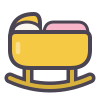</a> **Cradle** Kołyska `kolyska` · v1 · [raw](https://raw.githubusercontent.com/tobob/pastelki-assets/main/svg/domki/kolyska.svg) · [site](https://pastelki.club/en/image/kolyska?utm_source=github&utm_medium=gallery&utm_campaign=pastelki-assets) | <a href="../svg/domki/komin.svg">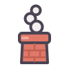</a> **Chimney with smoke** Komin `komin` · v1 · [raw](https://raw.githubusercontent.com/tobob/pastelki-assets/main/svg/domki/komin.svg) · [site](https://pastelki.club/en/image/komin?utm_source=github&utm_medium=gallery&utm_campaign=pastelki-assets) |  **Fireplace** Kominek `kominek` · v1 · [raw](https://raw.githubusercontent.com/tobob/pastelki-assets/main/svg/domki/kominek.svg) · [site](https://pastelki.club/en/image/kominek?utm_source=github&utm_medium=gallery&utm_campaign=pastelki-assets) |  **Lighthouse** Latarnia morska `latarnia-morska` · v1 · [raw](https://raw.githubusercontent.com/tobob/pastelki-assets/main/svg/domki/latarnia-morska.svg) · [site](https://pastelki.club/en/image/latarnia-morska?utm_source=github&utm_medium=gallery&utm_campaign=pastelki-assets) |
| <a href="../svg/domki/maly-domek-z-ogrodkiem.svg">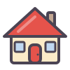</a> **Little house** Mały domek z ogródkiem `maly-domek-z-ogrodkiem` · v1 · [raw](https://raw.githubusercontent.com/tobob/pastelki-assets/main/svg/domki/maly-domek-z-ogrodkiem.svg) · [site](https://pastelki.club/en/image/maly-domek-z-ogrodkiem?utm_source=github&utm_medium=gallery&utm_campaign=pastelki-assets) | <a href="../svg/domki/namiot.svg">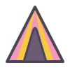</a> **Tent** Namiot `namiot` · v1 · [raw](https://raw.githubusercontent.com/tobob/pastelki-assets/main/svg/domki/namiot.svg) · [site](https://pastelki.club/en/image/namiot?utm_source=github&utm_medium=gallery&utm_campaign=pastelki-assets) |  **Nest** Gniazdo `nest` · v1 · [raw](https://raw.githubusercontent.com/tobob/pastelki-assets/main/svg/domki/nest.svg) · [site](https://pastelki.club/en/image/nest?utm_source=github&utm_medium=gallery&utm_campaign=pastelki-assets) | <a href="../svg/domki/ptaszek-w-gniezdzie.svg">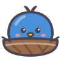</a> **Bird in a nest** Ptaszek w gnieździe `ptaszek-w-gniezdzie` · v1 · [raw](https://raw.githubusercontent.com/tobob/pastelki-assets/main/svg/domki/ptaszek-w-gniezdzie.svg) · [site](https://pastelki.club/en/image/ptaszek-w-gniezdzie?utm_source=github&utm_medium=gallery&utm_campaign=pastelki-assets) |
|  **Little shop** Sklep `sklep` · v1 · [raw](https://raw.githubusercontent.com/tobob/pastelki-assets/main/svg/domki/sklep.svg) · [site](https://pastelki.club/en/image/sklep?utm_source=github&utm_medium=gallery&utm_campaign=pastelki-assets) | <a href="../svg/domki/skrzynka-z-klockami.svg">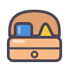</a> **Toy chest** Skrzynka z klockami `skrzynka-z-klockami` · v1 · [raw](https://raw.githubusercontent.com/tobob/pastelki-assets/main/svg/domki/skrzynka-z-klockami.svg) · [site](https://pastelki.club/en/image/skrzynka-z-klockami?utm_source=github&utm_medium=gallery&utm_campaign=pastelki-assets) | <a href="../svg/domki/trojkatny-namiot-cyrkowy.svg">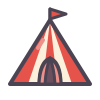</a> **Circus tent** Trójkątny namiot cyrkowy `trojkatny-namiot-cyrkowy` · v1 · [raw](https://raw.githubusercontent.com/tobob/pastelki-assets/main/svg/domki/trojkatny-namiot-cyrkowy.svg) · [site](https://pastelki.club/en/image/trojkatny-namiot-cyrkowy?utm_source=github&utm_medium=gallery&utm_campaign=pastelki-assets) | <a href="../svg/domki/wiatrak.svg">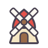</a> **Windmill** Wiatrak `wiatrak` · v1 · [raw](https://raw.githubusercontent.com/tobob/pastelki-assets/main/svg/domki/wiatrak.svg) · [site](https://pastelki.club/en/image/wiatrak?utm_source=github&utm_medium=gallery&utm_campaign=pastelki-assets) |
|  **Sandcastle** Zamek z piasku `zamek-z-piasku` · v1 · [raw](https://raw.githubusercontent.com/tobob/pastelki-assets/main/svg/domki/zamek-z-piasku.svg) · [site](https://pastelki.club/en/image/zamek-z-piasku?utm_source=github&utm_medium=gallery&utm_campaign=pastelki-assets) | <a href="../svg/domki/zegar-z-kukulka.svg">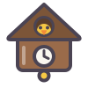</a> **Cuckoo clock** Zegar z kukułką `zegar-z-kukulka` · v1 · [raw](https://raw.githubusercontent.com/tobob/pastelki-assets/main/svg/domki/zegar-z-kukulka.svg) · [site](https://pastelki.club/en/image/zegar-z-kukulka?utm_source=github&utm_medium=gallery&utm_campaign=pastelki-assets) |  |  |
