# Food · Jedzenie

35 pictures · [all categories](README.md) · [back to the repository](../README.md)

<!-- generated by scripts/sync.py — do not edit by hand -->

| | | | |
|:-:|:-:|:-:|:-:|
|  **Pineapple** Ananas `ananas` · v1 · [raw](https://raw.githubusercontent.com/tobob/pastelki-assets/main/svg/jedzenie/ananas.svg) · [site](https://pastelki.club/en/image/ananas?utm_source=github&utm_medium=gallery&utm_campaign=pastelki-assets) |  **Apple** Jabłko `apple` · v3 · [raw](https://raw.githubusercontent.com/tobob/pastelki-assets/main/svg/jedzenie/apple.svg) · [site](https://pastelki.club/en/image/apple?utm_source=github&utm_medium=gallery&utm_campaign=pastelki-assets) |  **Banana** Banan `banana` · v3 · [raw](https://raw.githubusercontent.com/tobob/pastelki-assets/main/svg/jedzenie/banana.svg) · [site](https://pastelki.club/en/image/banana?utm_source=github&utm_medium=gallery&utm_campaign=pastelki-assets) | <a href="../svg/jedzenie/blueberries.svg">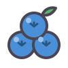</a> **Blueberries** Borówki `blueberries` · v3 · [raw](https://raw.githubusercontent.com/tobob/pastelki-assets/main/svg/jedzenie/blueberries.svg) · [site](https://pastelki.club/en/image/blueberries?utm_source=github&utm_medium=gallery&utm_campaign=pastelki-assets) |
|  **Bone** Kość `bone` · v1 · [raw](https://raw.githubusercontent.com/tobob/pastelki-assets/main/svg/jedzenie/bone.svg) · [site](https://pastelki.club/en/image/bone?utm_source=github&utm_medium=gallery&utm_campaign=pastelki-assets) | <a href="../svg/jedzenie/bread.svg">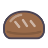</a> **Bread** Chleb `bread` · v3 · [raw](https://raw.githubusercontent.com/tobob/pastelki-assets/main/svg/jedzenie/bread.svg) · [site](https://pastelki.club/en/image/bread?utm_source=github&utm_medium=gallery&utm_campaign=pastelki-assets) |  **Broccoli** Brokuł `brokul` · v1 · [raw](https://raw.githubusercontent.com/tobob/pastelki-assets/main/svg/jedzenie/brokul.svg) · [site](https://pastelki.club/en/image/brokul?utm_source=github&utm_medium=gallery&utm_campaign=pastelki-assets) |  **Cake** Tort `cake` · v3 · [raw](https://raw.githubusercontent.com/tobob/pastelki-assets/main/svg/jedzenie/cake.svg) · [site](https://pastelki.club/en/image/cake?utm_source=github&utm_medium=gallery&utm_campaign=pastelki-assets) |
|  **Carrot** Marchewka `carrot` · v1 · [raw](https://raw.githubusercontent.com/tobob/pastelki-assets/main/svg/jedzenie/carrot.svg) · [site](https://pastelki.club/en/image/carrot?utm_source=github&utm_medium=gallery&utm_campaign=pastelki-assets) |  **Cheese** Ser `cheese` · v1 · [raw](https://raw.githubusercontent.com/tobob/pastelki-assets/main/svg/jedzenie/cheese.svg) · [site](https://pastelki.club/en/image/cheese?utm_source=github&utm_medium=gallery&utm_campaign=pastelki-assets) | <a href="../svg/jedzenie/cherry.svg">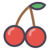</a> **Cherries** Wiśnie `cherry` · v3 · [raw](https://raw.githubusercontent.com/tobob/pastelki-assets/main/svg/jedzenie/cherry.svg) · [site](https://pastelki.club/en/image/cherry?utm_source=github&utm_medium=gallery&utm_campaign=pastelki-assets) |  **Cookie** Ciastko `ciastko` · v1 · [raw](https://raw.githubusercontent.com/tobob/pastelki-assets/main/svg/jedzenie/ciastko.svg) · [site](https://pastelki.club/en/image/ciastko?utm_source=github&utm_medium=gallery&utm_campaign=pastelki-assets) |
|  **Corn** Kukurydza `corn` · v1 · [raw](https://raw.githubusercontent.com/tobob/pastelki-assets/main/svg/jedzenie/corn.svg) · [site](https://pastelki.club/en/image/corn?utm_source=github&utm_medium=gallery&utm_campaign=pastelki-assets) | <a href="../svg/jedzenie/egg.svg">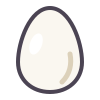</a> **Egg** Jajko `egg` · v3 · [raw](https://raw.githubusercontent.com/tobob/pastelki-assets/main/svg/jedzenie/egg.svg) · [site](https://pastelki.club/en/image/egg?utm_source=github&utm_medium=gallery&utm_campaign=pastelki-assets) | <a href="../svg/jedzenie/grapes.svg">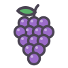</a> **Grapes** Winogrona `grapes` · v3 · [raw](https://raw.githubusercontent.com/tobob/pastelki-assets/main/svg/jedzenie/grapes.svg) · [site](https://pastelki.club/en/image/grapes?utm_source=github&utm_medium=gallery&utm_campaign=pastelki-assets) | <a href="../svg/jedzenie/hay.svg">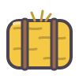</a> **Hay** Siano `hay` · v3 · [raw](https://raw.githubusercontent.com/tobob/pastelki-assets/main/svg/jedzenie/hay.svg) · [site](https://pastelki.club/en/image/hay?utm_source=github&utm_medium=gallery&utm_campaign=pastelki-assets) |
|  **Honey** Miód `honey` · v3 · [raw](https://raw.githubusercontent.com/tobob/pastelki-assets/main/svg/jedzenie/honey.svg) · [site](https://pastelki.club/en/image/honey?utm_source=github&utm_medium=gallery&utm_campaign=pastelki-assets) |  **Kiwi** Kiwi `kiwi` · v1 · [raw](https://raw.githubusercontent.com/tobob/pastelki-assets/main/svg/jedzenie/kiwi.svg) · [site](https://pastelki.club/en/image/kiwi?utm_source=github&utm_medium=gallery&utm_campaign=pastelki-assets) | <a href="../svg/jedzenie/lemon.svg">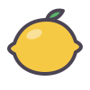</a> **Lemon** Cytryna `lemon` · v3 · [raw](https://raw.githubusercontent.com/tobob/pastelki-assets/main/svg/jedzenie/lemon.svg) · [site](https://pastelki.club/en/image/lemon?utm_source=github&utm_medium=gallery&utm_campaign=pastelki-assets) |  **Ice cream cone** Lody w rożku `lody-w-rozku` · v1 · [raw](https://raw.githubusercontent.com/tobob/pastelki-assets/main/svg/jedzenie/lody-w-rozku.svg) · [site](https://pastelki.club/en/image/lody-w-rozku?utm_source=github&utm_medium=gallery&utm_campaign=pastelki-assets) |
|  **Milk** Mleko `milk` · v1 · [raw](https://raw.githubusercontent.com/tobob/pastelki-assets/main/svg/jedzenie/milk.svg) · [site](https://pastelki.club/en/image/milk?utm_source=github&utm_medium=gallery&utm_campaign=pastelki-assets) | <a href="../svg/jedzenie/ogorek.svg">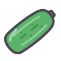</a> **Cucumber** Ogórek `ogorek` · v1 · [raw](https://raw.githubusercontent.com/tobob/pastelki-assets/main/svg/jedzenie/ogorek.svg) · [site](https://pastelki.club/en/image/ogorek?utm_source=github&utm_medium=gallery&utm_campaign=pastelki-assets) |  **Orange** Pomarańcza `orange` · v3 · [raw](https://raw.githubusercontent.com/tobob/pastelki-assets/main/svg/jedzenie/orange.svg) · [site](https://pastelki.club/en/image/orange?utm_source=github&utm_medium=gallery&utm_campaign=pastelki-assets) | <a href="../svg/jedzenie/pear.svg">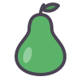</a> **Pear** Gruszka `pear` · v3 · [raw](https://raw.githubusercontent.com/tobob/pastelki-assets/main/svg/jedzenie/pear.svg) · [site](https://pastelki.club/en/image/pear?utm_source=github&utm_medium=gallery&utm_campaign=pastelki-assets) |
|  **Peas** Groszek `peas` · v1 · [raw](https://raw.githubusercontent.com/tobob/pastelki-assets/main/svg/jedzenie/peas.svg) · [site](https://pastelki.club/en/image/peas?utm_source=github&utm_medium=gallery&utm_campaign=pastelki-assets) | <a href="../svg/jedzenie/pierogi.svg">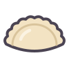</a> **Dumpling** Pierogi `pierogi` · v1 · [raw](https://raw.githubusercontent.com/tobob/pastelki-assets/main/svg/jedzenie/pierogi.svg) · [site](https://pastelki.club/en/image/pierogi?utm_source=github&utm_medium=gallery&utm_campaign=pastelki-assets) |  **Pizza** Pizza `pizza` · v1 · [raw](https://raw.githubusercontent.com/tobob/pastelki-assets/main/svg/jedzenie/pizza.svg) · [site](https://pastelki.club/en/image/pizza?utm_source=github&utm_medium=gallery&utm_campaign=pastelki-assets) | <a href="../svg/jedzenie/plum.svg">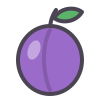</a> **Plum** Śliwka `plum` · v3 · [raw](https://raw.githubusercontent.com/tobob/pastelki-assets/main/svg/jedzenie/plum.svg) · [site](https://pastelki.club/en/image/plum?utm_source=github&utm_medium=gallery&utm_campaign=pastelki-assets) |
|  **Pumpkin** Dynia `pumpkin` · v3 · [raw](https://raw.githubusercontent.com/tobob/pastelki-assets/main/svg/jedzenie/pumpkin.svg) · [site](https://pastelki.club/en/image/pumpkin?utm_source=github&utm_medium=gallery&utm_campaign=pastelki-assets) |  **Croissant** Rogalik `rogalik` · v1 · [raw](https://raw.githubusercontent.com/tobob/pastelki-assets/main/svg/jedzenie/rogalik.svg) · [site](https://pastelki.club/en/image/rogalik?utm_source=github&utm_medium=gallery&utm_campaign=pastelki-assets) | <a href="../svg/jedzenie/sandwich.svg">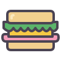</a> **Sandwich** Kanapka `sandwich` · v7 · [raw](https://raw.githubusercontent.com/tobob/pastelki-assets/main/svg/jedzenie/sandwich.svg) · [site](https://pastelki.club/en/image/sandwich?utm_source=github&utm_medium=gallery&utm_campaign=pastelki-assets) |  **Strawberry** Truskawka `strawberry` · v3 · [raw](https://raw.githubusercontent.com/tobob/pastelki-assets/main/svg/jedzenie/strawberry.svg) · [site](https://pastelki.club/en/image/strawberry?utm_source=github&utm_medium=gallery&utm_campaign=pastelki-assets) |
|  **Tomato** Pomidor `tomato` · v3 · [raw](https://raw.githubusercontent.com/tobob/pastelki-assets/main/svg/jedzenie/tomato.svg) · [site](https://pastelki.club/en/image/tomato?utm_source=github&utm_medium=gallery&utm_campaign=pastelki-assets) | <a href="../svg/jedzenie/watermelon.svg">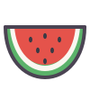</a> **Watermelon** Arbuz `watermelon` · v1 · [raw](https://raw.githubusercontent.com/tobob/pastelki-assets/main/svg/jedzenie/watermelon.svg) · [site](https://pastelki.club/en/image/watermelon?utm_source=github&utm_medium=gallery&utm_campaign=pastelki-assets) | <a href="../svg/jedzenie/zolta-gruszka-z-lisciem.svg">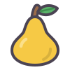</a> **Pear with a leaf** Żółta gruszka z liściem `zolta-gruszka-z-lisciem` · v1 · [raw](https://raw.githubusercontent.com/tobob/pastelki-assets/main/svg/jedzenie/zolta-gruszka-z-lisciem.svg) · [site](https://pastelki.club/en/image/zolta-gruszka-z-lisciem?utm_source=github&utm_medium=gallery&utm_campaign=pastelki-assets) |  |
