# Baby animals · Zwierzęce maluchy

24 pictures · [all categories](README.md) · [back to the repository](../README.md)

<!-- generated by scripts/sync.py — do not edit by hand -->

| | | | |
|:-:|:-:|:-:|:-:|
| <a href="../svg/maluchy/chick.svg">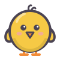</a> **Chick** Kurczątko `chick` · v4 · [raw](https://raw.githubusercontent.com/tobob/pastelki-assets/main/svg/maluchy/chick.svg) · [site](https://pastelki.club/en/image/chick?utm_source=github&utm_medium=gallery&utm_campaign=pastelki-assets) | <a href="../svg/maluchy/chomik.svg">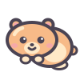</a> **Hamster** Chomik `chomik` · v1 · [raw](https://raw.githubusercontent.com/tobob/pastelki-assets/main/svg/maluchy/chomik.svg) · [site](https://pastelki.club/en/image/chomik?utm_source=github&utm_medium=gallery&utm_campaign=pastelki-assets) |  **Little calf** Cielątko `cielatko` · v1 · [raw](https://raw.githubusercontent.com/tobob/pastelki-assets/main/svg/maluchy/cielatko.svg) · [site](https://pastelki.club/en/image/cielatko?utm_source=github&utm_medium=gallery&utm_campaign=pastelki-assets) | <a href="../svg/maluchy/duckling.svg">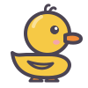</a> **Duckling** Kaczątko `duckling` · v4 · [raw](https://raw.githubusercontent.com/tobob/pastelki-assets/main/svg/maluchy/duckling.svg) · [site](https://pastelki.club/en/image/duckling?utm_source=github&utm_medium=gallery&utm_campaign=pastelki-assets) |
|  **Baby wild boar** Dzik `dzik` · v1 · [raw](https://raw.githubusercontent.com/tobob/pastelki-assets/main/svg/maluchy/dzik.svg) · [site](https://pastelki.club/en/image/dzik?utm_source=github&utm_medium=gallery&utm_campaign=pastelki-assets) |  **Baby seal** Foka maluch `foka-maluch` · v1 · [raw](https://raw.githubusercontent.com/tobob/pastelki-assets/main/svg/maluchy/foka-maluch.svg) · [site](https://pastelki.club/en/image/foka-maluch?utm_source=github&utm_medium=gallery&utm_campaign=pastelki-assets) | <a href="../svg/maluchy/golabek-w-gniezdzie.svg">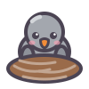</a> **Little pigeon in a nest** Gołąbek w gnieździe `golabek-w-gniezdzie` · v1 · [raw](https://raw.githubusercontent.com/tobob/pastelki-assets/main/svg/maluchy/golabek-w-gniezdzie.svg) · [site](https://pastelki.club/en/image/golabek-w-gniezdzie?utm_source=github&utm_medium=gallery&utm_campaign=pastelki-assets) |  **Baby hedgehog** Jeżyk `jezyk` · v1 · [raw](https://raw.githubusercontent.com/tobob/pastelki-assets/main/svg/maluchy/jezyk.svg) · [site](https://pastelki.club/en/image/jezyk?utm_source=github&utm_medium=gallery&utm_campaign=pastelki-assets) |
|  **Duckling with mama** Kaczuszka z mamą `kaczuszka-z-mama` · v4 · [raw](https://raw.githubusercontent.com/tobob/pastelki-assets/main/svg/maluchy/kaczuszka-z-mama.svg) · [site](https://pastelki.club/en/image/kaczuszka-z-mama?utm_source=github&utm_medium=gallery&utm_campaign=pastelki-assets) | <a href="../svg/maluchy/kangurek-w-woreczku.svg">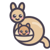</a> **Baby kangaroo in pouch** Kangurek w woreczku `kangurek-w-woreczku` · v1 · [raw](https://raw.githubusercontent.com/tobob/pastelki-assets/main/svg/maluchy/kangurek-w-woreczku.svg) · [site](https://pastelki.club/en/image/kangurek-w-woreczku?utm_source=github&utm_medium=gallery&utm_campaign=pastelki-assets) |  **Kitten** Kotek `kitten` · v4 · [raw](https://raw.githubusercontent.com/tobob/pastelki-assets/main/svg/maluchy/kitten.svg) · [site](https://pastelki.club/en/image/kitten?utm_source=github&utm_medium=gallery&utm_campaign=pastelki-assets) | <a href="../svg/maluchy/koala-maluch.svg">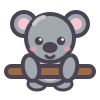</a> **Baby koala** Koala maluch `koala-maluch` · v1 · [raw](https://raw.githubusercontent.com/tobob/pastelki-assets/main/svg/maluchy/koala-maluch.svg) · [site](https://pastelki.club/en/image/koala-maluch?utm_source=github&utm_medium=gallery&utm_campaign=pastelki-assets) |
| <a href="../svg/maluchy/kotek-ze-skarpetka.svg">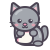</a> **Kitten with a sock** Kotek ze skarpetką `kotek-ze-skarpetka` · v1 · [raw](https://raw.githubusercontent.com/tobob/pastelki-assets/main/svg/maluchy/kotek-ze-skarpetka.svg) · [site](https://pastelki.club/en/image/kotek-ze-skarpetka?utm_source=github&utm_medium=gallery&utm_campaign=pastelki-assets) | <a href="../svg/maluchy/kozlatko.svg">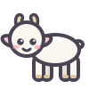</a> **Kid goat** Koźlątko `kozlatko` · v2 · [raw](https://raw.githubusercontent.com/tobob/pastelki-assets/main/svg/maluchy/kozlatko.svg) · [site](https://pastelki.club/en/image/kozlatko?utm_source=github&utm_medium=gallery&utm_campaign=pastelki-assets) | <a href="../svg/maluchy/krokodylek-maluch.svg">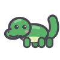</a> **Baby crocodile** Krokodylek maluch `krokodylek-maluch` · v1 · [raw](https://raw.githubusercontent.com/tobob/pastelki-assets/main/svg/maluchy/krokodylek-maluch.svg) · [site](https://pastelki.club/en/image/krokodylek-maluch?utm_source=github&utm_medium=gallery&utm_campaign=pastelki-assets) | <a href="../svg/maluchy/lamb.svg">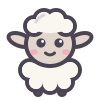</a> **Lamb** Owieczka `lamb` · v2 · [raw](https://raw.githubusercontent.com/tobob/pastelki-assets/main/svg/maluchy/lamb.svg) · [site](https://pastelki.club/en/image/lamb?utm_source=github&utm_medium=gallery&utm_campaign=pastelki-assets) |
| <a href="../svg/maluchy/maly-pies-szczeniak-z-pilka.svg">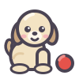</a> **Puppy with a ball** Mały pies szczeniak z piłką `maly-pies-szczeniak-z-pilka` · v1 · [raw](https://raw.githubusercontent.com/tobob/pastelki-assets/main/svg/maluchy/maly-pies-szczeniak-z-pilka.svg) · [site](https://pastelki.club/en/image/maly-pies-szczeniak-z-pilka?utm_source=github&utm_medium=gallery&utm_campaign=pastelki-assets) |  **Fox cub** Młode lisiątko `mlode-lisiatko` · v1 · [raw](https://raw.githubusercontent.com/tobob/pastelki-assets/main/svg/maluchy/mlode-lisiatko.svg) · [site](https://pastelki.club/en/image/mlode-lisiatko?utm_source=github&utm_medium=gallery&utm_campaign=pastelki-assets) | <a href="../svg/maluchy/mlody-slon.svg">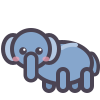</a> **Baby elephant** Młody słoń `mlody-slon` · v1 · [raw](https://raw.githubusercontent.com/tobob/pastelki-assets/main/svg/maluchy/mlody-slon.svg) · [site](https://pastelki.club/en/image/mlody-slon?utm_source=github&utm_medium=gallery&utm_campaign=pastelki-assets) | <a href="../svg/maluchy/mors-maluch.svg">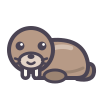</a> **Baby walrus** Mors maluch `mors-maluch` · v1 · [raw](https://raw.githubusercontent.com/tobob/pastelki-assets/main/svg/maluchy/mors-maluch.svg) · [site](https://pastelki.club/en/image/mors-maluch?utm_source=github&utm_medium=gallery&utm_campaign=pastelki-assets) |
| <a href="../svg/maluchy/pluszowy-zajac.svg">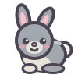</a> **Plush bunny** Pluszowy zając `pluszowy-zajac` · v2 · [raw](https://raw.githubusercontent.com/tobob/pastelki-assets/main/svg/maluchy/pluszowy-zajac.svg) · [site](https://pastelki.club/en/image/pluszowy-zajac?utm_source=github&utm_medium=gallery&utm_campaign=pastelki-assets) | <a href="../svg/maluchy/prosiaczek.svg">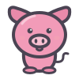</a> **Piglet** Prosiaczek `prosiaczek` · v2 · [raw](https://raw.githubusercontent.com/tobob/pastelki-assets/main/svg/maluchy/prosiaczek.svg) · [site](https://pastelki.club/en/image/prosiaczek?utm_source=github&utm_medium=gallery&utm_campaign=pastelki-assets) |  **Puppy** Szczeniaczek `puppy` · v4 · [raw](https://raw.githubusercontent.com/tobob/pastelki-assets/main/svg/maluchy/puppy.svg) · [site](https://pastelki.club/en/image/puppy?utm_source=github&utm_medium=gallery&utm_campaign=pastelki-assets) | <a href="../svg/maluchy/zrebaczek.svg">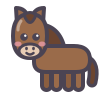</a> **Foal** Źrebaczek `zrebaczek` · v5 · [raw](https://raw.githubusercontent.com/tobob/pastelki-assets/main/svg/maluchy/zrebaczek.svg) · [site](https://pastelki.club/en/image/zrebaczek?utm_source=github&utm_medium=gallery&utm_campaign=pastelki-assets) |
