# Sea creatures · Morskie stworzenia

19 pictures · [all categories](README.md) · [back to the repository](../README.md)

<!-- generated by scripts/sync.py — do not edit by hand -->

| | | | |
|:-:|:-:|:-:|:-:|
|  **Squid** Kałamarnica `kalamarnica` · v1 · [raw](https://raw.githubusercontent.com/tobob/pastelki-assets/main/svg/morze/kalamarnica.svg) · [site](https://pastelki.club/en/image/kalamarnica?utm_source=github&utm_medium=gallery&utm_campaign=pastelki-assets) | <a href="../svg/morze/kalamarnica-w-okularach.svg">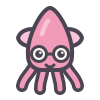</a> **Squid with glasses** Kałamarnica w okularach `kalamarnica-w-okularach` · v1 · [raw](https://raw.githubusercontent.com/tobob/pastelki-assets/main/svg/morze/kalamarnica-w-okularach.svg) · [site](https://pastelki.club/en/image/kalamarnica-w-okularach?utm_source=github&utm_medium=gallery&utm_campaign=pastelki-assets) | <a href="../svg/morze/konik-morski.svg">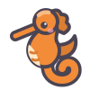</a> **Seahorse** Konik morski `konik-morski` · v5 · [raw](https://raw.githubusercontent.com/tobob/pastelki-assets/main/svg/morze/konik-morski.svg) · [site](https://pastelki.club/en/image/konik-morski?utm_source=github&utm_medium=gallery&utm_campaign=pastelki-assets) | <a href="../svg/morze/krewetka.svg">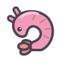</a> **Shrimp** Krewetka `krewetka` · v4 · [raw](https://raw.githubusercontent.com/tobob/pastelki-assets/main/svg/morze/krewetka.svg) · [site](https://pastelki.club/en/image/krewetka?utm_source=github&utm_medium=gallery&utm_campaign=pastelki-assets) |
| <a href="../svg/morze/lodz-podwodna.svg">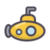</a> **Submarine** Łódź podwodna `lodz-podwodna` · v2 · [raw](https://raw.githubusercontent.com/tobob/pastelki-assets/main/svg/morze/lodz-podwodna.svg) · [site](https://pastelki.club/en/image/lodz-podwodna?utm_source=github&utm_medium=gallery&utm_campaign=pastelki-assets) |  **Jellyfish** Meduza `meduza` · v4 · [raw](https://raw.githubusercontent.com/tobob/pastelki-assets/main/svg/morze/meduza.svg) · [site](https://pastelki.club/en/image/meduza?utm_source=github&utm_medium=gallery&utm_campaign=pastelki-assets) |  **Seagull** Mewa `mewa` · v1 · [raw](https://raw.githubusercontent.com/tobob/pastelki-assets/main/svg/morze/mewa.svg) · [site](https://pastelki.club/en/image/mewa?utm_source=github&utm_medium=gallery&utm_campaign=pastelki-assets) |  **Walrus** Mors `mors-2` · v1 · [raw](https://raw.githubusercontent.com/tobob/pastelki-assets/main/svg/morze/mors-2.svg) · [site](https://pastelki.club/en/image/mors-2?utm_source=github&utm_medium=gallery&utm_campaign=pastelki-assets) |
| <a href="../svg/morze/narwal.svg">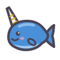</a> **Narwhal** Narwal `narwal` · v3 · [raw](https://raw.githubusercontent.com/tobob/pastelki-assets/main/svg/morze/narwal.svg) · [site](https://pastelki.club/en/image/narwal?utm_source=github&utm_medium=gallery&utm_campaign=pastelki-assets) | <a href="../svg/morze/osmiorniczka-w-kapeluszu.svg">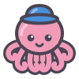</a> **Little octopus in a hat** Ośmiorniczka w kapeluszu `osmiorniczka-w-kapeluszu` · v1 · [raw](https://raw.githubusercontent.com/tobob/pastelki-assets/main/svg/morze/osmiorniczka-w-kapeluszu.svg) · [site](https://pastelki.club/en/image/osmiorniczka-w-kapeluszu?utm_source=github&utm_medium=gallery&utm_campaign=pastelki-assets) | <a href="../svg/morze/rak-pustelnik.svg">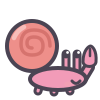</a> **Hermit crab** Rak pustelnik `rak-pustelnik` · v4 · [raw](https://raw.githubusercontent.com/tobob/pastelki-assets/main/svg/morze/rak-pustelnik.svg) · [site](https://pastelki.club/en/image/rak-pustelnik?utm_source=github&utm_medium=gallery&utm_campaign=pastelki-assets) |  **Shark** Rekin `rekin` · v4 · [raw](https://raw.githubusercontent.com/tobob/pastelki-assets/main/svg/morze/rekin.svg) · [site](https://pastelki.club/en/image/rekin?utm_source=github&utm_medium=gallery&utm_campaign=pastelki-assets) |
| <a href="../svg/morze/rekin-wielorybi.svg">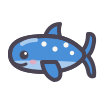</a> **Whale shark** Rekin wielorybi `rekin-wielorybi` · v2 · [raw](https://raw.githubusercontent.com/tobob/pastelki-assets/main/svg/morze/rekin-wielorybi.svg) · [site](https://pastelki.club/en/image/rekin-wielorybi?utm_source=github&utm_medium=gallery&utm_campaign=pastelki-assets) | <a href="../svg/morze/rozgwiazda.svg">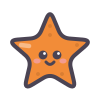</a> **Starfish** Rozgwiazda `rozgwiazda` · v4 · [raw](https://raw.githubusercontent.com/tobob/pastelki-assets/main/svg/morze/rozgwiazda.svg) · [site](https://pastelki.club/en/image/rozgwiazda?utm_source=github&utm_medium=gallery&utm_campaign=pastelki-assets) | <a href="../svg/morze/ryba-morska.svg">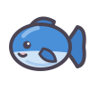</a> **Little sea fish** Ryba morska `ryba-morska` · v1 · [raw](https://raw.githubusercontent.com/tobob/pastelki-assets/main/svg/morze/ryba-morska.svg) · [site](https://pastelki.club/en/image/ryba-morska?utm_source=github&utm_medium=gallery&utm_campaign=pastelki-assets) |  **Ship** Statek `statek` · v2 · [raw](https://raw.githubusercontent.com/tobob/pastelki-assets/main/svg/morze/statek.svg) · [site](https://pastelki.club/en/image/statek?utm_source=github&utm_medium=gallery&utm_campaign=pastelki-assets) |
| <a href="../svg/morze/wydra-morska.svg">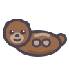</a> **Sea otter** Wydra morska `wydra-morska` · v1 · [raw](https://raw.githubusercontent.com/tobob/pastelki-assets/main/svg/morze/wydra-morska.svg) · [site](https://pastelki.club/en/image/wydra-morska?utm_source=github&utm_medium=gallery&utm_campaign=pastelki-assets) | <a href="../svg/morze/zlota-rybka-w-misce.svg">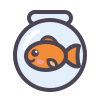</a> **Goldfish in a bowl** Złota rybka w misce `zlota-rybka-w-misce` · v1 · [raw](https://raw.githubusercontent.com/tobob/pastelki-assets/main/svg/morze/zlota-rybka-w-misce.svg) · [site](https://pastelki.club/en/image/zlota-rybka-w-misce?utm_source=github&utm_medium=gallery&utm_campaign=pastelki-assets) | <a href="../svg/morze/zolw-morski.svg">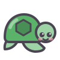</a> **Sea turtle** Żółw morski `zolw-morski` · v5 · [raw](https://raw.githubusercontent.com/tobob/pastelki-assets/main/svg/morze/zolw-morski.svg) · [site](https://pastelki.club/en/image/zolw-morski?utm_source=github&utm_medium=gallery&utm_campaign=pastelki-assets) |  |
