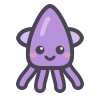
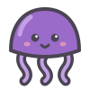
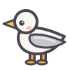
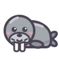
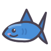
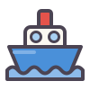

# Sea creatures · Morskie stworzenia

12 pictures · [all categories](README.md) · [back to the repository](../README.md)

<!-- generated by scripts/sync.py — do not edit by hand -->

| | | | |
|:-:|:-:|:-:|:-:|
|  **Squid** Kałamarnica `kalamarnica` · v1 · [raw](https://raw.githubusercontent.com/tobob/pastelki-assets/main/svg/morze/kalamarnica.svg) · [site](https://pastelki.club/en/image/kalamarnica) |  **Seahorse** Konik morski `konik-morski` · v4 · [raw](https://raw.githubusercontent.com/tobob/pastelki-assets/main/svg/morze/konik-morski.svg) · [site](https://pastelki.club/en/image/konik-morski) |  **Shrimp** Krewetka `krewetka` · v4 · [raw](https://raw.githubusercontent.com/tobob/pastelki-assets/main/svg/morze/krewetka.svg) · [site](https://pastelki.club/en/image/krewetka) |  **Jellyfish** Meduza `meduza` · v4 · [raw](https://raw.githubusercontent.com/tobob/pastelki-assets/main/svg/morze/meduza.svg) · [site](https://pastelki.club/en/image/meduza) |
|  **Seagull** Mewa `mewa` · v1 · [raw](https://raw.githubusercontent.com/tobob/pastelki-assets/main/svg/morze/mewa.svg) · [site](https://pastelki.club/en/image/mewa) |  **Walrus** Mors `mors-2` · v1 · [raw](https://raw.githubusercontent.com/tobob/pastelki-assets/main/svg/morze/mors-2.svg) · [site](https://pastelki.club/en/image/mors-2) |  **Narwhal** Narwal `narwal` · v3 · [raw](https://raw.githubusercontent.com/tobob/pastelki-assets/main/svg/morze/narwal.svg) · [site](https://pastelki.club/en/image/narwal) |  **Hermit crab** Rak pustelnik `rak-pustelnik` · v3 · [raw](https://raw.githubusercontent.com/tobob/pastelki-assets/main/svg/morze/rak-pustelnik.svg) · [site](https://pastelki.club/en/image/rak-pustelnik) |
|  **Shark** Rekin `rekin` · v4 · [raw](https://raw.githubusercontent.com/tobob/pastelki-assets/main/svg/morze/rekin.svg) · [site](https://pastelki.club/en/image/rekin) |  **Starfish** Rozgwiazda `rozgwiazda` · v4 · [raw](https://raw.githubusercontent.com/tobob/pastelki-assets/main/svg/morze/rozgwiazda.svg) · [site](https://pastelki.club/en/image/rozgwiazda) |  **Ship** Statek `statek` · v1 · [raw](https://raw.githubusercontent.com/tobob/pastelki-assets/main/svg/morze/statek.svg) · [site](https://pastelki.club/en/image/statek) |  **Sea turtle** Żółw morski `zolw-morski` · v5 · [raw](https://raw.githubusercontent.com/tobob/pastelki-assets/main/svg/morze/zolw-morski.svg) · [site](https://pastelki.club/en/image/zolw-morski) |
