# Nature & weather · Natura i pogoda

27 pictures · [all categories](README.md) · [back to the repository](../README.md)

<!-- generated by scripts/sync.py — do not edit by hand -->

| | | | |
|:-:|:-:|:-:|:-:|
| <a href="../svg/natura/acorn.svg">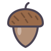</a> **Acorn** Żołądź `acorn` · v3 · [raw](https://raw.githubusercontent.com/tobob/pastelki-assets/main/svg/natura/acorn.svg) · [site](https://pastelki.club/en/image/acorn?utm_source=github&utm_medium=gallery&utm_campaign=pastelki-assets) |  **Cloud** Chmurka `cloud` · v3 · [raw](https://raw.githubusercontent.com/tobob/pastelki-assets/main/svg/natura/cloud.svg) · [site](https://pastelki.club/en/image/cloud?utm_source=github&utm_medium=gallery&utm_campaign=pastelki-assets) | <a href="../svg/natura/dmuchawiec.svg">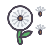</a> **Dandelion clock** Dmuchawiec `dmuchawiec` · v1 · [raw](https://raw.githubusercontent.com/tobob/pastelki-assets/main/svg/natura/dmuchawiec.svg) · [site](https://pastelki.club/en/image/dmuchawiec?utm_source=github&utm_medium=gallery&utm_campaign=pastelki-assets) | <a href="../svg/natura/flower.svg">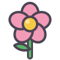</a> **Flower** Kwiatek `flower` · v1 · [raw](https://raw.githubusercontent.com/tobob/pastelki-assets/main/svg/natura/flower.svg) · [site](https://pastelki.club/en/image/flower?utm_source=github&utm_medium=gallery&utm_campaign=pastelki-assets) |
|  **Iceberg** Góra lodowa `iceberg` · v1 · [raw](https://raw.githubusercontent.com/tobob/pastelki-assets/main/svg/natura/iceberg.svg) · [site](https://pastelki.club/en/image/iceberg?utm_source=github&utm_medium=gallery&utm_campaign=pastelki-assets) | <a href="../svg/natura/kaczka-na-stawie.svg">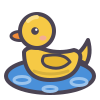</a> **Duck on a pond** Kaczka na stawie `kaczka-na-stawie` · v1 · [raw](https://raw.githubusercontent.com/tobob/pastelki-assets/main/svg/natura/kaczka-na-stawie.svg) · [site](https://pastelki.club/en/image/kaczka-na-stawie?utm_source=github&utm_medium=gallery&utm_campaign=pastelki-assets) |  **Cactus in a pot** Kaktus `kaktus` · v1 · [raw](https://raw.githubusercontent.com/tobob/pastelki-assets/main/svg/natura/kaktus.svg) · [site](https://pastelki.club/en/image/kaktus?utm_source=github&utm_medium=gallery&utm_campaign=pastelki-assets) | <a href="../svg/natura/kamien.svg">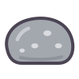</a> **Stone** Kamień `kamien` · v1 · [raw](https://raw.githubusercontent.com/tobob/pastelki-assets/main/svg/natura/kamien.svg) · [site](https://pastelki.club/en/image/kamien?utm_source=github&utm_medium=gallery&utm_campaign=pastelki-assets) |
| <a href="../svg/natura/kielek.svg">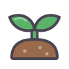</a> **Sprout** Kiełek `kielek` · v1 · [raw](https://raw.githubusercontent.com/tobob/pastelki-assets/main/svg/natura/kielek.svg) · [site](https://pastelki.club/en/image/kielek?utm_source=github&utm_medium=gallery&utm_campaign=pastelki-assets) |  **Leaf** Listek `leaf` · v1 · [raw](https://raw.githubusercontent.com/tobob/pastelki-assets/main/svg/natura/leaf.svg) · [site](https://pastelki.club/en/image/leaf?utm_source=github&utm_medium=gallery&utm_campaign=pastelki-assets) |  **Moon** Księżyc `moon` · v3 · [raw](https://raw.githubusercontent.com/tobob/pastelki-assets/main/svg/natura/moon.svg) · [site](https://pastelki.club/en/image/moon?utm_source=github&utm_medium=gallery&utm_campaign=pastelki-assets) | <a href="../svg/natura/mushroom.svg">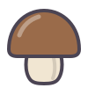</a> **Mushroom** Grzybek `mushroom` · v3 · [raw](https://raw.githubusercontent.com/tobob/pastelki-assets/main/svg/natura/mushroom.svg) · [site](https://pastelki.club/en/image/mushroom?utm_source=github&utm_medium=gallery&utm_campaign=pastelki-assets) |
| <a href="../svg/natura/muszelka.svg">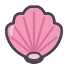</a> **Seashell** Muszelka `muszelka` · v1 · [raw](https://raw.githubusercontent.com/tobob/pastelki-assets/main/svg/natura/muszelka.svg) · [site](https://pastelki.club/en/image/muszelka?utm_source=github&utm_medium=gallery&utm_campaign=pastelki-assets) | <a href="../svg/natura/nasionko.svg">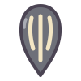</a> **Seed** Nasionko `nasionko` · v1 · [raw](https://raw.githubusercontent.com/tobob/pastelki-assets/main/svg/natura/nasionko.svg) · [site](https://pastelki.club/en/image/nasionko?utm_source=github&utm_medium=gallery&utm_campaign=pastelki-assets) | <a href="../svg/natura/pond.svg">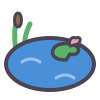</a> **Pond** Staw `pond` · v1 · [raw](https://raw.githubusercontent.com/tobob/pastelki-assets/main/svg/natura/pond.svg) · [site](https://pastelki.club/en/image/pond?utm_source=github&utm_medium=gallery&utm_campaign=pastelki-assets) |  **Rainbow** Tęcza `rainbow` · v1 · [raw](https://raw.githubusercontent.com/tobob/pastelki-assets/main/svg/natura/rainbow.svg) · [site](https://pastelki.club/en/image/rainbow?utm_source=github&utm_medium=gallery&utm_campaign=pastelki-assets) |
| <a href="../svg/natura/raindrop.svg">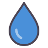</a> **Raindrop** Kropla deszczu `raindrop` · v3 · [raw](https://raw.githubusercontent.com/tobob/pastelki-assets/main/svg/natura/raindrop.svg) · [site](https://pastelki.club/en/image/raindrop?utm_source=github&utm_medium=gallery&utm_campaign=pastelki-assets) |  **Sea** Morze `sea` · v3 · [raw](https://raw.githubusercontent.com/tobob/pastelki-assets/main/svg/natura/sea.svg) · [site](https://pastelki.club/en/image/sea?utm_source=github&utm_medium=gallery&utm_campaign=pastelki-assets) |  **Sunflower** Słonecznik `slonecznik` · v3 · [raw](https://raw.githubusercontent.com/tobob/pastelki-assets/main/svg/natura/slonecznik.svg) · [site](https://pastelki.club/en/image/slonecznik?utm_source=github&utm_medium=gallery&utm_campaign=pastelki-assets) |  **Sunflower in a pot** Słonecznik w doniczce `slonecznik-w-doniczce` · v1 · [raw](https://raw.githubusercontent.com/tobob/pastelki-assets/main/svg/natura/slonecznik-w-doniczce.svg) · [site](https://pastelki.club/en/image/slonecznik-w-doniczce?utm_source=github&utm_medium=gallery&utm_campaign=pastelki-assets) |
|  **Snowflake** Płatek śniegu `snowflake` · v1 · [raw](https://raw.githubusercontent.com/tobob/pastelki-assets/main/svg/natura/snowflake.svg) · [site](https://pastelki.club/en/image/snowflake?utm_source=github&utm_medium=gallery&utm_campaign=pastelki-assets) |  **Star** Gwiazdka `star` · v1 · [raw](https://raw.githubusercontent.com/tobob/pastelki-assets/main/svg/natura/star.svg) · [site](https://pastelki.club/en/image/star?utm_source=github&utm_medium=gallery&utm_campaign=pastelki-assets) |  **Daisy** Stokrotka `stokrotka` · v3 · [raw](https://raw.githubusercontent.com/tobob/pastelki-assets/main/svg/natura/stokrotka.svg) · [site](https://pastelki.club/en/image/stokrotka?utm_source=github&utm_medium=gallery&utm_campaign=pastelki-assets) |  **Sun** Słońce `sun` · v3 · [raw](https://raw.githubusercontent.com/tobob/pastelki-assets/main/svg/natura/sun.svg) · [site](https://pastelki.club/en/image/sun?utm_source=github&utm_medium=gallery&utm_campaign=pastelki-assets) |
|  **Tree** Drzewo `tree` · v3 · [raw](https://raw.githubusercontent.com/tobob/pastelki-assets/main/svg/natura/tree.svg) · [site](https://pastelki.club/en/image/tree?utm_source=github&utm_medium=gallery&utm_campaign=pastelki-assets) |  **Tulip** Tulipan `tulipan` · v1 · [raw](https://raw.githubusercontent.com/tobob/pastelki-assets/main/svg/natura/tulipan.svg) · [site](https://pastelki.club/en/image/tulipan?utm_source=github&utm_medium=gallery&utm_campaign=pastelki-assets) |  **Frog with an umbrella** Żaba z parasolką `zaba-z-parasolka` · v1 · [raw](https://raw.githubusercontent.com/tobob/pastelki-assets/main/svg/natura/zaba-z-parasolka.svg) · [site](https://pastelki.club/en/image/zaba-z-parasolka?utm_source=github&utm_medium=gallery&utm_campaign=pastelki-assets) |  |
