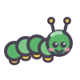
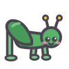
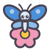

# Bugs & insects · Owady i robaczki

12 pictures · [all categories](README.md) · [back to the repository](../README.md)

<!-- generated by scripts/sync.py — do not edit by hand -->

| | | | |
|:-:|:-:|:-:|:-:|
|  **Ladybug on a leaf** Biedronka na liściu `biedronka-na-lisciu` · v3 · [raw](https://raw.githubusercontent.com/tobob/pastelki-assets/main/svg/owady/biedronka-na-lisciu.svg) · [site](https://pastelki.club/en/image/biedronka-na-lisciu) |  **Caterpillar** Gąsienica `gasienica` · v5 · [raw](https://raw.githubusercontent.com/tobob/pastelki-assets/main/svg/owady/gasienica.svg) · [site](https://pastelki.club/en/image/gasienica) |  **Grasshopper** Konik polny `konik-polny` · v1 · [raw](https://raw.githubusercontent.com/tobob/pastelki-assets/main/svg/owady/konik-polny.svg) · [site](https://pastelki.club/en/image/konik-polny) |  **Butterfly on a flower** Motyl na kwiatku `motyl-na-kwiatku` · v1 · [raw](https://raw.githubusercontent.com/tobob/pastelki-assets/main/svg/owady/motyl-na-kwiatku.svg) · [site](https://pastelki.club/en/image/motyl-na-kwiatku) |
|  **Ant** Mrówka `mrowka` · v4 · [raw](https://raw.githubusercontent.com/tobob/pastelki-assets/main/svg/owady/mrowka.svg) · [site](https://pastelki.club/en/image/mrowka) |  **Wasp** Osa `osa` · v1 · [raw](https://raw.githubusercontent.com/tobob/pastelki-assets/main/svg/owady/osa.svg) · [site](https://pastelki.club/en/image/osa) |  **Spider** Pająk `pajak` · v4 · [raw](https://raw.githubusercontent.com/tobob/pastelki-assets/main/svg/owady/pajak.svg) · [site](https://pastelki.club/en/image/pajak) |  **Bee on a flower** Pszczółka na kwiatku `pszczolka-na-kwiatku` · v2 · [raw](https://raw.githubusercontent.com/tobob/pastelki-assets/main/svg/owady/pszczolka-na-kwiatku.svg) · [site](https://pastelki.club/en/image/pszczolka-na-kwiatku) |
|  **Firefly** Świetlik `swietlik` · v5 · [raw](https://raw.githubusercontent.com/tobob/pastelki-assets/main/svg/owady/swietlik.svg) · [site](https://pastelki.club/en/image/swietlik) |  **Dragonfly** Ważka `wazka` · v2 · [raw](https://raw.githubusercontent.com/tobob/pastelki-assets/main/svg/owady/wazka.svg) · [site](https://pastelki.club/en/image/wazka) |  **Frog on a lily pad** Żaba na liściu lilii `zaba-na-lisciu-lilii` · v1 · [raw](https://raw.githubusercontent.com/tobob/pastelki-assets/main/svg/owady/zaba-na-lisciu-lilii.svg) · [site](https://pastelki.club/en/image/zaba-na-lisciu-lilii) |  **Little beetle** Żuk `zuk` · v2 · [raw](https://raw.githubusercontent.com/tobob/pastelki-assets/main/svg/owady/zuk.svg) · [site](https://pastelki.club/en/image/zuk) |
