# Bugs & insects · Owady i robaczki

18 pictures · [all categories](README.md) · [back to the repository](../README.md)

<!-- generated by scripts/sync.py — do not edit by hand -->

| | | | |
|:-:|:-:|:-:|:-:|
|  **Ladybug on a leaf** Biedronka na liściu `biedronka-na-lisciu` · v3 · [raw](https://raw.githubusercontent.com/tobob/pastelki-assets/main/svg/owady/biedronka-na-lisciu.svg) · [site](https://pastelki.club/en/image/biedronka-na-lisciu?utm_source=github&utm_medium=gallery&utm_campaign=pastelki-assets) |  **Caterpillar** Gąsienica `gasienica` · v5 · [raw](https://raw.githubusercontent.com/tobob/pastelki-assets/main/svg/owady/gasienica.svg) · [site](https://pastelki.club/en/image/gasienica?utm_source=github&utm_medium=gallery&utm_campaign=pastelki-assets) | <a href="../svg/owady/komar.svg">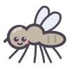</a> **Mosquito** Komar `komar` · v1 · [raw](https://raw.githubusercontent.com/tobob/pastelki-assets/main/svg/owady/komar.svg) · [site](https://pastelki.club/en/image/komar?utm_source=github&utm_medium=gallery&utm_campaign=pastelki-assets) |  **Grasshopper** Konik polny `konik-polny` · v1 · [raw](https://raw.githubusercontent.com/tobob/pastelki-assets/main/svg/owady/konik-polny.svg) · [site](https://pastelki.club/en/image/konik-polny?utm_source=github&utm_medium=gallery&utm_campaign=pastelki-assets) |
|  **Butterfly on a flower** Motyl na kwiatku `motyl-na-kwiatku` · v1 · [raw](https://raw.githubusercontent.com/tobob/pastelki-assets/main/svg/owady/motyl-na-kwiatku.svg) · [site](https://pastelki.club/en/image/motyl-na-kwiatku?utm_source=github&utm_medium=gallery&utm_campaign=pastelki-assets) | <a href="../svg/owady/mrowka.svg">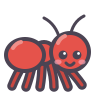</a> **Ant** Mrówka `mrowka` · v4 · [raw](https://raw.githubusercontent.com/tobob/pastelki-assets/main/svg/owady/mrowka.svg) · [site](https://pastelki.club/en/image/mrowka?utm_source=github&utm_medium=gallery&utm_campaign=pastelki-assets) | <a href="../svg/owady/osa.svg">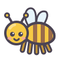</a> **Wasp** Osa `osa` · v1 · [raw](https://raw.githubusercontent.com/tobob/pastelki-assets/main/svg/owady/osa.svg) · [site](https://pastelki.club/en/image/osa?utm_source=github&utm_medium=gallery&utm_campaign=pastelki-assets) | <a href="../svg/owady/pajak.svg">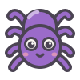</a> **Spider** Pająk `pajak` · v4 · [raw](https://raw.githubusercontent.com/tobob/pastelki-assets/main/svg/owady/pajak.svg) · [site](https://pastelki.club/en/image/pajak?utm_source=github&utm_medium=gallery&utm_campaign=pastelki-assets) |
| <a href="../svg/owady/pszczolka-na-kwiatku.svg">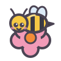</a> **Bee on a flower** Pszczółka na kwiatku `pszczolka-na-kwiatku` · v2 · [raw](https://raw.githubusercontent.com/tobob/pastelki-assets/main/svg/owady/pszczolka-na-kwiatku.svg) · [site](https://pastelki.club/en/image/pszczolka-na-kwiatku?utm_source=github&utm_medium=gallery&utm_campaign=pastelki-assets) | <a href="../svg/owady/ropucha.svg">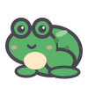</a> **Toad** Ropucha `ropucha` · v1 · [raw](https://raw.githubusercontent.com/tobob/pastelki-assets/main/svg/owady/ropucha.svg) · [site](https://pastelki.club/en/image/ropucha?utm_source=github&utm_medium=gallery&utm_campaign=pastelki-assets) | <a href="../svg/owady/slimak-w-muszli-na-lisciu.svg">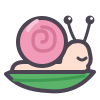</a> **Snail on a leaf** Ślimak w muszli na liściu `slimak-w-muszli-na-lisciu` · v1 · [raw](https://raw.githubusercontent.com/tobob/pastelki-assets/main/svg/owady/slimak-w-muszli-na-lisciu.svg) · [site](https://pastelki.club/en/image/slimak-w-muszli-na-lisciu?utm_source=github&utm_medium=gallery&utm_campaign=pastelki-assets) | <a href="../svg/owady/stonoga.svg">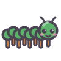</a> **Centipede** Stonoga `stonoga` · v1 · [raw](https://raw.githubusercontent.com/tobob/pastelki-assets/main/svg/owady/stonoga.svg) · [site](https://pastelki.club/en/image/stonoga?utm_source=github&utm_medium=gallery&utm_campaign=pastelki-assets) |
| <a href="../svg/owady/swietlik.svg">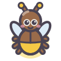</a> **Firefly** Świetlik `swietlik` · v5 · [raw](https://raw.githubusercontent.com/tobob/pastelki-assets/main/svg/owady/swietlik.svg) · [site](https://pastelki.club/en/image/swietlik?utm_source=github&utm_medium=gallery&utm_campaign=pastelki-assets) | <a href="../svg/owady/trzmiel.svg">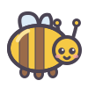</a> **Bumblebee** Trzmiel `trzmiel` · v4 · [raw](https://raw.githubusercontent.com/tobob/pastelki-assets/main/svg/owady/trzmiel.svg) · [site](https://pastelki.club/en/image/trzmiel?utm_source=github&utm_medium=gallery&utm_campaign=pastelki-assets) | <a href="../svg/owady/wazka.svg">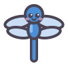</a> **Dragonfly** Ważka `wazka` · v2 · [raw](https://raw.githubusercontent.com/tobob/pastelki-assets/main/svg/owady/wazka.svg) · [site](https://pastelki.club/en/image/wazka?utm_source=github&utm_medium=gallery&utm_campaign=pastelki-assets) | <a href="../svg/owady/zaba-na-lisciu-lilii.svg">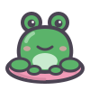</a> **Frog on a lily pad** Żaba na liściu lilii `zaba-na-lisciu-lilii` · v1 · [raw](https://raw.githubusercontent.com/tobob/pastelki-assets/main/svg/owady/zaba-na-lisciu-lilii.svg) · [site](https://pastelki.club/en/image/zaba-na-lisciu-lilii?utm_source=github&utm_medium=gallery&utm_campaign=pastelki-assets) |
| <a href="../svg/owady/zielona-gasienica-na-jablku.svg">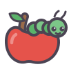</a> **Caterpillar on an apple** Zielona gąsienica na jabłku `zielona-gasienica-na-jablku` · v1 · [raw](https://raw.githubusercontent.com/tobob/pastelki-assets/main/svg/owady/zielona-gasienica-na-jablku.svg) · [site](https://pastelki.club/en/image/zielona-gasienica-na-jablku?utm_source=github&utm_medium=gallery&utm_campaign=pastelki-assets) | <a href="../svg/owady/zuk.svg">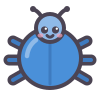</a> **Little beetle** Żuk `zuk` · v2 · [raw](https://raw.githubusercontent.com/tobob/pastelki-assets/main/svg/owady/zuk.svg) · [site](https://pastelki.club/en/image/zuk?utm_source=github&utm_medium=gallery&utm_campaign=pastelki-assets) |  |  |
