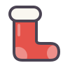

# Celebrations · Święta i przyjęcia

14 pictures · [all categories](README.md) · [back to the repository](../README.md)

<!-- generated by scripts/sync.py — do not edit by hand -->

| | | | |
|:-:|:-:|:-:|:-:|
|  **Balloon on a string** Balonik na sznurku `balonik-na-sznurku` · v1 · [raw](https://raw.githubusercontent.com/tobob/pastelki-assets/main/svg/swieta/balonik-na-sznurku.svg) · [site](https://pastelki.club/en/image/balonik-na-sznurku) |  **Balloons** Balony `balony` · v3 · [raw](https://raw.githubusercontent.com/tobob/pastelki-assets/main/svg/swieta/balony.svg) · [site](https://pastelki.club/en/image/balony) |  **Snowman with a broom** Bałwanek z miotłą `balwanek-z-miotla` · v1 · [raw](https://raw.githubusercontent.com/tobob/pastelki-assets/main/svg/swieta/balwanek-z-miotla.svg) · [site](https://pastelki.club/en/image/balwanek-z-miotla) |  **Christmas tree** Choinka `choinka` · v1 · [raw](https://raw.githubusercontent.com/tobob/pastelki-assets/main/svg/swieta/choinka.svg) · [site](https://pastelki.club/en/image/choinka) |
|  **Christmas bauble** Choinkowa bombka `choinkowa-bombka` · v3 · [raw](https://raw.githubusercontent.com/tobob/pastelki-assets/main/svg/swieta/choinkowa-bombka.svg) · [site](https://pastelki.club/en/image/choinkowa-bombka) |  **Pumpkin lantern** Dyniowa lampa `dyniowa-lampa` · v1 · [raw](https://raw.githubusercontent.com/tobob/pastelki-assets/main/svg/swieta/dyniowa-lampa.svg) · [site](https://pastelki.club/en/image/dyniowa-lampa) |  **Bell** Dzwonek `dzwonek` · v4 · [raw](https://raw.githubusercontent.com/tobob/pastelki-assets/main/svg/swieta/dzwonek.svg) · [site](https://pastelki.club/en/image/dzwonek) |  **Firework** Fajerwerk `fajerwerk` · v1 · [raw](https://raw.githubusercontent.com/tobob/pastelki-assets/main/svg/swieta/fajerwerk.svg) · [site](https://pastelki.club/en/image/fajerwerk) |
|  **Wizard hat** Kapelusz czarodzieja `kapelusz-czarodzieja` · v1 · [raw](https://raw.githubusercontent.com/tobob/pastelki-assets/main/svg/swieta/kapelusz-czarodzieja.svg) · [site](https://pastelki.club/en/image/kapelusz-czarodzieja) |  **Garden gnome** Krasnoludek `krasnoludek` · v3 · [raw](https://raw.githubusercontent.com/tobob/pastelki-assets/main/svg/swieta/krasnoludek.svg) · [site](https://pastelki.club/en/image/krasnoludek) |  **Santa Claus** Mikołaj `mikolaj` · v1 · [raw](https://raw.githubusercontent.com/tobob/pastelki-assets/main/svg/swieta/mikolaj.svg) · [site](https://pastelki.club/en/image/mikolaj) |  **Chick hatching from an egg** Pisklę w jajku `piskle-w-jajku` · v1 · [raw](https://raw.githubusercontent.com/tobob/pastelki-assets/main/svg/swieta/piskle-w-jajku.svg) · [site](https://pastelki.club/en/image/piskle-w-jajku) |
|  **Christmas stocking** Skarpeta świąteczna `skarpeta-swiateczna` · v1 · [raw](https://raw.githubusercontent.com/tobob/pastelki-assets/main/svg/swieta/skarpeta-swiateczna.svg) · [site](https://pastelki.club/en/image/skarpeta-swiateczna) |  **Birthday candle** Urodzinowa świeczka `urodzinowa-swieczka` · v1 · [raw](https://raw.githubusercontent.com/tobob/pastelki-assets/main/svg/swieta/urodzinowa-swieczka.svg) · [site](https://pastelki.club/en/image/urodzinowa-swieczka) |  |  |
