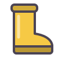
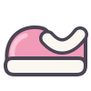
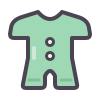
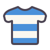
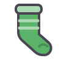
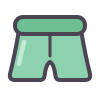

# Clothes · Ubranka

15 pictures · [all categories](README.md) · [back to the repository](../README.md)

<!-- generated by scripts/sync.py — do not edit by hand -->

| | | | |
|:-:|:-:|:-:|:-:|
|  **Rain boot** Kalosz `boot` · v1 · [raw](https://raw.githubusercontent.com/tobob/pastelki-assets/main/svg/ubrania/boot.svg) · [site](https://pastelki.club/en/image/boot) |  **Hat** Czapka `hat` · v1 · [raw](https://raw.githubusercontent.com/tobob/pastelki-assets/main/svg/ubrania/hat.svg) · [site](https://pastelki.club/en/image/hat) |  **Slipper** Kapcie `kapcie` · v5 · [raw](https://raw.githubusercontent.com/tobob/pastelki-assets/main/svg/ubrania/kapcie.svg) · [site](https://pastelki.club/en/image/kapcie) |  **Straw hat** Kapelusz słomkowy `kapelusz-slomkowy` · v3 · [raw](https://raw.githubusercontent.com/tobob/pastelki-assets/main/svg/ubrania/kapelusz-slomkowy.svg) · [site](https://pastelki.club/en/image/kapelusz-slomkowy) |
|  **Romper** Kombinezon `kombinezon` · v1 · [raw](https://raw.githubusercontent.com/tobob/pastelki-assets/main/svg/ubrania/kombinezon.svg) · [site](https://pastelki.club/en/image/kombinezon) |  **T-shirt** Koszulka `koszulka` · v1 · [raw](https://raw.githubusercontent.com/tobob/pastelki-assets/main/svg/ubrania/koszulka.svg) · [site](https://pastelki.club/en/image/koszulka) |  **Striped t-shirt** Koszulka w paski `koszulka-w-paski` · v1 · [raw](https://raw.githubusercontent.com/tobob/pastelki-assets/main/svg/ubrania/koszulka-w-paski.svg) · [site](https://pastelki.club/en/image/koszulka-w-paski) |  **Mitten** Rękawiczka `mitten` · v1 · [raw](https://raw.githubusercontent.com/tobob/pastelki-assets/main/svg/ubrania/mitten.svg) · [site](https://pastelki.club/en/image/mitten) |
|  **Raincoat** Płaszczyk przeciwdeszczowy `plaszczyk-przeciwdeszczowy` · v1 · [raw](https://raw.githubusercontent.com/tobob/pastelki-assets/main/svg/ubrania/plaszczyk-przeciwdeszczowy.svg) · [site](https://pastelki.club/en/image/plaszczyk-przeciwdeszczowy) |  **Scarf** Szalik `scarf` · v1 · [raw](https://raw.githubusercontent.com/tobob/pastelki-assets/main/svg/ubrania/scarf.svg) · [site](https://pastelki.club/en/image/scarf) |  **Shoe** Bucik `shoe` · v1 · [raw](https://raw.githubusercontent.com/tobob/pastelki-assets/main/svg/ubrania/shoe.svg) · [site](https://pastelki.club/en/image/shoe) |  **Sock** Skarpetka `sock` · v1 · [raw](https://raw.githubusercontent.com/tobob/pastelki-assets/main/svg/ubrania/sock.svg) · [site](https://pastelki.club/en/image/sock) |
|  **Shorts** Spodenki `spodenki` · v3 · [raw](https://raw.githubusercontent.com/tobob/pastelki-assets/main/svg/ubrania/spodenki.svg) · [site](https://pastelki.club/en/image/spodenki) |  **Sunglasses** Okulary przeciwsłoneczne `sunglasses` · v1 · [raw](https://raw.githubusercontent.com/tobob/pastelki-assets/main/svg/ubrania/sunglasses.svg) · [site](https://pastelki.club/en/image/sunglasses) |  **Sweater with a heart** Sweter `sweter` · v3 · [raw](https://raw.githubusercontent.com/tobob/pastelki-assets/main/svg/ubrania/sweter.svg) · [site](https://pastelki.club/en/image/sweter) |  |
