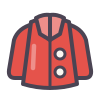
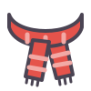
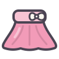

# Clothes · Ubranka

23 pictures · [all categories](README.md) · [back to the repository](../README.md)

<!-- generated by scripts/sync.py — do not edit by hand -->

| | | | |
|:-:|:-:|:-:|:-:|
|  **Rain boot** Kalosz `boot` · v1 · [raw](https://raw.githubusercontent.com/tobob/pastelki-assets/main/svg/ubrania/boot.svg) · [site](https://pastelki.club/en/image/boot?utm_source=github&utm_medium=gallery&utm_campaign=pastelki-assets) |  **Baseball cap** Czapka z daszkiem `czapka-z-daszkiem` · v1 · [raw](https://raw.githubusercontent.com/tobob/pastelki-assets/main/svg/ubrania/czapka-z-daszkiem.svg) · [site](https://pastelki.club/en/image/czapka-z-daszkiem?utm_source=github&utm_medium=gallery&utm_campaign=pastelki-assets) |  **Hat** Czapka `hat` · v1 · [raw](https://raw.githubusercontent.com/tobob/pastelki-assets/main/svg/ubrania/hat.svg) · [site](https://pastelki.club/en/image/hat?utm_source=github&utm_medium=gallery&utm_campaign=pastelki-assets) |  **Slipper** Kapcie `kapcie` · v5 · [raw](https://raw.githubusercontent.com/tobob/pastelki-assets/main/svg/ubrania/kapcie.svg) · [site](https://pastelki.club/en/image/kapcie?utm_source=github&utm_medium=gallery&utm_campaign=pastelki-assets) |
|  **Wizard hat with stars** Kapelusz czarodzieja z gwiazdkami `kapelusz-czarodzieja-z-gwiazdkami` · v1 · [raw](https://raw.githubusercontent.com/tobob/pastelki-assets/main/svg/ubrania/kapelusz-czarodzieja-z-gwiazdkami.svg) · [site](https://pastelki.club/en/image/kapelusz-czarodzieja-z-gwiazdkami?utm_source=github&utm_medium=gallery&utm_campaign=pastelki-assets) |  **Cowboy hat** Kapelusz kowbojski `kapelusz-kowbojski` · v1 · [raw](https://raw.githubusercontent.com/tobob/pastelki-assets/main/svg/ubrania/kapelusz-kowbojski.svg) · [site](https://pastelki.club/en/image/kapelusz-kowbojski?utm_source=github&utm_medium=gallery&utm_campaign=pastelki-assets) |  **Straw hat** Kapelusz słomkowy `kapelusz-slomkowy` · v3 · [raw](https://raw.githubusercontent.com/tobob/pastelki-assets/main/svg/ubrania/kapelusz-slomkowy.svg) · [site](https://pastelki.club/en/image/kapelusz-slomkowy?utm_source=github&utm_medium=gallery&utm_campaign=pastelki-assets) |  **Romper** Kombinezon `kombinezon` · v1 · [raw](https://raw.githubusercontent.com/tobob/pastelki-assets/main/svg/ubrania/kombinezon.svg) · [site](https://pastelki.club/en/image/kombinezon?utm_source=github&utm_medium=gallery&utm_campaign=pastelki-assets) |
|  **T-shirt** Koszulka `koszulka` · v1 · [raw](https://raw.githubusercontent.com/tobob/pastelki-assets/main/svg/ubrania/koszulka.svg) · [site](https://pastelki.club/en/image/koszulka?utm_source=github&utm_medium=gallery&utm_campaign=pastelki-assets) |  **Striped t-shirt** Koszulka w paski `koszulka-w-paski` · v1 · [raw](https://raw.githubusercontent.com/tobob/pastelki-assets/main/svg/ubrania/koszulka-w-paski.svg) · [site](https://pastelki.club/en/image/koszulka-w-paski?utm_source=github&utm_medium=gallery&utm_campaign=pastelki-assets) |  **Pocket tee** Koszulka z kieszonką `koszulka-z-kieszonka` · v1 · [raw](https://raw.githubusercontent.com/tobob/pastelki-assets/main/svg/ubrania/koszulka-z-kieszonka.svg) · [site](https://pastelki.club/en/image/koszulka-z-kieszonka?utm_source=github&utm_medium=gallery&utm_campaign=pastelki-assets) |  **Mitten** Rękawiczka `mitten` · v1 · [raw](https://raw.githubusercontent.com/tobob/pastelki-assets/main/svg/ubrania/mitten.svg) · [site](https://pastelki.club/en/image/mitten?utm_source=github&utm_medium=gallery&utm_campaign=pastelki-assets) |
|  **Coat** Płaszcz `plaszcz` · v1 · [raw](https://raw.githubusercontent.com/tobob/pastelki-assets/main/svg/ubrania/plaszcz.svg) · [site](https://pastelki.club/en/image/plaszcz?utm_source=github&utm_medium=gallery&utm_campaign=pastelki-assets) |  **Raincoat** Płaszczyk przeciwdeszczowy `plaszczyk-przeciwdeszczowy` · v1 · [raw](https://raw.githubusercontent.com/tobob/pastelki-assets/main/svg/ubrania/plaszczyk-przeciwdeszczowy.svg) · [site](https://pastelki.club/en/image/plaszczyk-przeciwdeszczowy?utm_source=github&utm_medium=gallery&utm_campaign=pastelki-assets) |  **Scarf** Szalik `scarf` · v1 · [raw](https://raw.githubusercontent.com/tobob/pastelki-assets/main/svg/ubrania/scarf.svg) · [site](https://pastelki.club/en/image/scarf?utm_source=github&utm_medium=gallery&utm_campaign=pastelki-assets) |  **Shoe** Bucik `shoe` · v1 · [raw](https://raw.githubusercontent.com/tobob/pastelki-assets/main/svg/ubrania/shoe.svg) · [site](https://pastelki.club/en/image/shoe?utm_source=github&utm_medium=gallery&utm_campaign=pastelki-assets) |
|  **Sock** Skarpetka `sock` · v1 · [raw](https://raw.githubusercontent.com/tobob/pastelki-assets/main/svg/ubrania/sock.svg) · [site](https://pastelki.club/en/image/sock?utm_source=github&utm_medium=gallery&utm_campaign=pastelki-assets) |  **Shorts** Spodenki `spodenki` · v3 · [raw](https://raw.githubusercontent.com/tobob/pastelki-assets/main/svg/ubrania/spodenki.svg) · [site](https://pastelki.club/en/image/spodenki?utm_source=github&utm_medium=gallery&utm_campaign=pastelki-assets) |  **Pink skirt** Spódniczka `spodniczka` · v1 · [raw](https://raw.githubusercontent.com/tobob/pastelki-assets/main/svg/ubrania/spodniczka.svg) · [site](https://pastelki.club/en/image/spodniczka?utm_source=github&utm_medium=gallery&utm_campaign=pastelki-assets) |  **Daisy crown** Stokrotkowy wianek `stokrotkowy-wianek` · v1 · [raw](https://raw.githubusercontent.com/tobob/pastelki-assets/main/svg/ubrania/stokrotkowy-wianek.svg) · [site](https://pastelki.club/en/image/stokrotkowy-wianek?utm_source=github&utm_medium=gallery&utm_campaign=pastelki-assets) |
|  **Sunglasses** Okulary przeciwsłoneczne `sunglasses` · v1 · [raw](https://raw.githubusercontent.com/tobob/pastelki-assets/main/svg/ubrania/sunglasses.svg) · [site](https://pastelki.club/en/image/sunglasses?utm_source=github&utm_medium=gallery&utm_campaign=pastelki-assets) |  **Sweater with a heart** Sweter `sweter` · v3 · [raw](https://raw.githubusercontent.com/tobob/pastelki-assets/main/svg/ubrania/sweter.svg) · [site](https://pastelki.club/en/image/sweter?utm_source=github&utm_medium=gallery&utm_campaign=pastelki-assets) |  **Yellow hooded raincoat** Sztormiak żółty z kapturem `sztormiak-zolty-z-kapturem` · v1 · [raw](https://raw.githubusercontent.com/tobob/pastelki-assets/main/svg/ubrania/sztormiak-zolty-z-kapturem.svg) · [site](https://pastelki.club/en/image/sztormiak-zolty-z-kapturem?utm_source=github&utm_medium=gallery&utm_campaign=pastelki-assets) |  |
