# Animals · Zwierzęta

61 pictures · [all categories](README.md) · [back to the repository](../README.md)

<!-- generated by scripts/sync.py — do not edit by hand -->

| | | | |
|:-:|:-:|:-:|:-:|
| <a href="../svg/zwierzeta/alpaka.svg">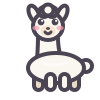</a> **Alpaca** Alpaka `alpaka` · v2 · [raw](https://raw.githubusercontent.com/tobob/pastelki-assets/main/svg/zwierzeta/alpaka.svg) · [site](https://pastelki.club/en/image/alpaka) | <a href="../svg/zwierzeta/bazant.svg">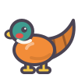</a> **Pheasant** Bażant `bazant` · v3 · [raw](https://raw.githubusercontent.com/tobob/pastelki-assets/main/svg/zwierzeta/bazant.svg) · [site](https://pastelki.club/en/image/bazant) | <a href="../svg/zwierzeta/bear.svg">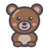</a> **Bear** Miś brunatny `bear` · v4 · [raw](https://raw.githubusercontent.com/tobob/pastelki-assets/main/svg/zwierzeta/bear.svg) · [site](https://pastelki.club/en/image/bear) | <a href="../svg/zwierzeta/bee.svg">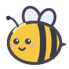</a> **Bee** Pszczoła `bee` · v4 · [raw](https://raw.githubusercontent.com/tobob/pastelki-assets/main/svg/zwierzeta/bee.svg) · [site](https://pastelki.club/en/image/bee) |
| <a href="../svg/zwierzeta/bird.svg">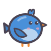</a> **Bird** Ptaszek `bird` · v4 · [raw](https://raw.githubusercontent.com/tobob/pastelki-assets/main/svg/zwierzeta/bird.svg) · [site](https://pastelki.club/en/image/bird) | <a href="../svg/zwierzeta/bobr.svg">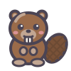</a> **Beaver** Bóbr `bobr` · v3 · [raw](https://raw.githubusercontent.com/tobob/pastelki-assets/main/svg/zwierzeta/bobr.svg) · [site](https://pastelki.club/en/image/bobr) | <a href="../svg/zwierzeta/butterfly.svg">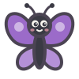</a> **Butterfly** Motyl `butterfly` · v2 · [raw](https://raw.githubusercontent.com/tobob/pastelki-assets/main/svg/zwierzeta/butterfly.svg) · [site](https://pastelki.club/en/image/butterfly) | <a href="../svg/zwierzeta/buzka-psa-2.svg">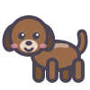</a> **Puppy** Piesek `buzka-psa-2` · v3 · [raw](https://raw.githubusercontent.com/tobob/pastelki-assets/main/svg/zwierzeta/buzka-psa-2.svg) · [site](https://pastelki.club/en/image/buzka-psa-2) |
| <a href="../svg/zwierzeta/cat.svg">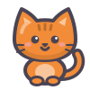</a> **Cat** Kot `cat` · v4 · [raw](https://raw.githubusercontent.com/tobob/pastelki-assets/main/svg/zwierzeta/cat.svg) · [site](https://pastelki.club/en/image/cat) | <a href="../svg/zwierzeta/crow.svg">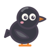</a> **Crow** Wrona `crow` · v2 · [raw](https://raw.githubusercontent.com/tobob/pastelki-assets/main/svg/zwierzeta/crow.svg) · [site](https://pastelki.club/en/image/crow) | <a href="../svg/zwierzeta/delfin.svg">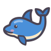</a> **Dolphin** Delfin `delfin` · v2 · [raw](https://raw.githubusercontent.com/tobob/pastelki-assets/main/svg/zwierzeta/delfin.svg) · [site](https://pastelki.club/en/image/delfin) | <a href="../svg/zwierzeta/dinosaur.svg">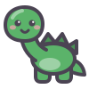</a> **Dinosaur** Dinozaur `dinosaur` · v4 · [raw](https://raw.githubusercontent.com/tobob/pastelki-assets/main/svg/zwierzeta/dinosaur.svg) · [site](https://pastelki.club/en/image/dinosaur) |
|  **Dog** Pies `dog` · v4 · [raw](https://raw.githubusercontent.com/tobob/pastelki-assets/main/svg/zwierzeta/dog.svg) · [site](https://pastelki.club/en/image/dog) | <a href="../svg/zwierzeta/duck.svg">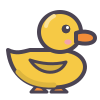</a> **Duck** Kaczka `duck` · v4 · [raw](https://raw.githubusercontent.com/tobob/pastelki-assets/main/svg/zwierzeta/duck.svg) · [site](https://pastelki.club/en/image/duck) | <a href="../svg/zwierzeta/dzieciol.svg">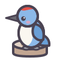</a> **Woodpecker** Dzięcioł `dzieciol` · v1 · [raw](https://raw.githubusercontent.com/tobob/pastelki-assets/main/svg/zwierzeta/dzieciol.svg) · [site](https://pastelki.club/en/image/dzieciol) | <a href="../svg/zwierzeta/fish.svg">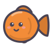</a> **Fish** Rybka `fish` · v4 · [raw](https://raw.githubusercontent.com/tobob/pastelki-assets/main/svg/zwierzeta/fish.svg) · [site](https://pastelki.club/en/image/fish) |
| <a href="../svg/zwierzeta/flamingo.svg">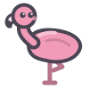</a> **Flamingo** Flaming `flamingo` · v4 · [raw](https://raw.githubusercontent.com/tobob/pastelki-assets/main/svg/zwierzeta/flamingo.svg) · [site](https://pastelki.club/en/image/flamingo) | <a href="../svg/zwierzeta/foka.svg">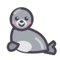</a> **Seal** Foka `foka` · v2 · [raw](https://raw.githubusercontent.com/tobob/pastelki-assets/main/svg/zwierzeta/foka.svg) · [site](https://pastelki.club/en/image/foka) | <a href="../svg/zwierzeta/fox.svg">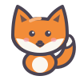</a> **Fox** Lis `fox` · v4 · [raw](https://raw.githubusercontent.com/tobob/pastelki-assets/main/svg/zwierzeta/fox.svg) · [site](https://pastelki.club/en/image/fox) | <a href="../svg/zwierzeta/frog.svg">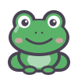</a> **Frog** Żaba `frog` · v4 · [raw](https://raw.githubusercontent.com/tobob/pastelki-assets/main/svg/zwierzeta/frog.svg) · [site](https://pastelki.club/en/image/frog) |
| <a href="../svg/zwierzeta/giraffe.svg">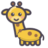</a> **Giraffe** Żyrafa `giraffe` · v4 · [raw](https://raw.githubusercontent.com/tobob/pastelki-assets/main/svg/zwierzeta/giraffe.svg) · [site](https://pastelki.club/en/image/giraffe) | <a href="../svg/zwierzeta/hedgehog.svg">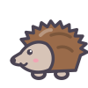</a> **Hedgehog** Jeż `hedgehog` · v4 · [raw](https://raw.githubusercontent.com/tobob/pastelki-assets/main/svg/zwierzeta/hedgehog.svg) · [site](https://pastelki.club/en/image/hedgehog) | <a href="../svg/zwierzeta/hen.svg">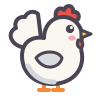</a> **Hen** Kura `hen` · v4 · [raw](https://raw.githubusercontent.com/tobob/pastelki-assets/main/svg/zwierzeta/hen.svg) · [site](https://pastelki.club/en/image/hen) | <a href="../svg/zwierzeta/hipopotam.svg">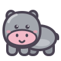</a> **Hippo** Hipopotam `hipopotam` · v2 · [raw](https://raw.githubusercontent.com/tobob/pastelki-assets/main/svg/zwierzeta/hipopotam.svg) · [site](https://pastelki.club/en/image/hipopotam) |
| <a href="../svg/zwierzeta/horse.svg">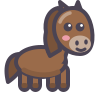</a> **Horse** Koń `horse` · v4 · [raw](https://raw.githubusercontent.com/tobob/pastelki-assets/main/svg/zwierzeta/horse.svg) · [site](https://pastelki.club/en/image/horse) | <a href="../svg/zwierzeta/kangur.svg">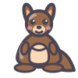</a> **Kangaroo** Kangur `kangur` · v5 · [raw](https://raw.githubusercontent.com/tobob/pastelki-assets/main/svg/zwierzeta/kangur.svg) · [site](https://pastelki.club/en/image/kangur) | <a href="../svg/zwierzeta/kapibara-2.svg">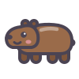</a> **Capybara** Kapibara `kapibara-2` · v1 · [raw](https://raw.githubusercontent.com/tobob/pastelki-assets/main/svg/zwierzeta/kapibara-2.svg) · [site](https://pastelki.club/en/image/kapibara-2) | <a href="../svg/zwierzeta/koala.svg">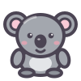</a> **Koala** Koala `koala` · v2 · [raw](https://raw.githubusercontent.com/tobob/pastelki-assets/main/svg/zwierzeta/koala.svg) · [site](https://pastelki.club/en/image/koala) |
| <a href="../svg/zwierzeta/kogut.svg">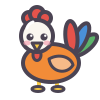</a> **Rooster** Kogut `kogut` · v5 · [raw](https://raw.githubusercontent.com/tobob/pastelki-assets/main/svg/zwierzeta/kogut.svg) · [site](https://pastelki.club/en/image/kogut) | <a href="../svg/zwierzeta/konik-polny-2.svg">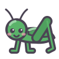</a> **Grasshopper** Konik polny `konik-polny-2` · v1 · [raw](https://raw.githubusercontent.com/tobob/pastelki-assets/main/svg/zwierzeta/konik-polny-2.svg) · [site](https://pastelki.club/en/image/konik-polny-2) | <a href="../svg/zwierzeta/krab.svg">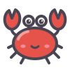</a> **Crab** Krab `krab` · v2 · [raw](https://raw.githubusercontent.com/tobob/pastelki-assets/main/svg/zwierzeta/krab.svg) · [site](https://pastelki.club/en/image/krab) | <a href="../svg/zwierzeta/krokodyl-przyjazny-bez-zebow.svg">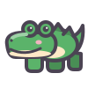</a> **Friendly crocodile** Krokodyl (przyjazny, bez zębów) `krokodyl-przyjazny-bez-zebow` · v4 · [raw](https://raw.githubusercontent.com/tobob/pastelki-assets/main/svg/zwierzeta/krokodyl-przyjazny-bez-zebow.svg) · [site](https://pastelki.club/en/image/krokodyl-przyjazny-bez-zebow) |
| <a href="../svg/zwierzeta/krowa.svg">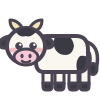</a> **Cow** Krowa `krowa` · v1 · [raw](https://raw.githubusercontent.com/tobob/pastelki-assets/main/svg/zwierzeta/krowa.svg) · [site](https://pastelki.club/en/image/krowa) | <a href="../svg/zwierzeta/ladybug.svg">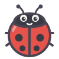</a> **Ladybug** Biedronka `ladybug` · v5 · [raw](https://raw.githubusercontent.com/tobob/pastelki-assets/main/svg/zwierzeta/ladybug.svg) · [site](https://pastelki.club/en/image/ladybug) |  **Lion** Lew `lew` · v1 · [raw](https://raw.githubusercontent.com/tobob/pastelki-assets/main/svg/zwierzeta/lew.svg) · [site](https://pastelki.club/en/image/lew) | <a href="../svg/zwierzeta/malpka.svg">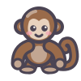</a> **Monkey** Małpka `malpka` · v1 · [raw](https://raw.githubusercontent.com/tobob/pastelki-assets/main/svg/zwierzeta/malpka.svg) · [site](https://pastelki.club/en/image/malpka) |
| <a href="../svg/zwierzeta/mouse.svg">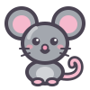</a> **Mouse** Myszka `mouse` · v4 · [raw](https://raw.githubusercontent.com/tobob/pastelki-assets/main/svg/zwierzeta/mouse.svg) · [site](https://pastelki.club/en/image/mouse) |  **Octopus** Ośmiornica `octopus` · v5 · [raw](https://raw.githubusercontent.com/tobob/pastelki-assets/main/svg/zwierzeta/octopus.svg) · [site](https://pastelki.club/en/image/octopus) | <a href="../svg/zwierzeta/osiolek.svg">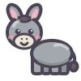</a> **Donkey** Osiołek `osiolek` · v4 · [raw](https://raw.githubusercontent.com/tobob/pastelki-assets/main/svg/zwierzeta/osiolek.svg) · [site](https://pastelki.club/en/image/osiolek) | <a href="../svg/zwierzeta/owl.svg">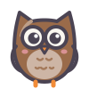</a> **Owl** Sowa `owl` · v4 · [raw](https://raw.githubusercontent.com/tobob/pastelki-assets/main/svg/zwierzeta/owl.svg) · [site](https://pastelki.club/en/image/owl) |
|  **Panda** Panda `panda` · v2 · [raw](https://raw.githubusercontent.com/tobob/pastelki-assets/main/svg/zwierzeta/panda.svg) · [site](https://pastelki.club/en/image/panda) | <a href="../svg/zwierzeta/parrot.svg">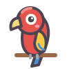</a> **Parrot** Papuga `parrot` · v4 · [raw](https://raw.githubusercontent.com/tobob/pastelki-assets/main/svg/zwierzeta/parrot.svg) · [site](https://pastelki.club/en/image/parrot) |  **Penguin** Pingwin `penguin` · v2 · [raw](https://raw.githubusercontent.com/tobob/pastelki-assets/main/svg/zwierzeta/penguin.svg) · [site](https://pastelki.club/en/image/penguin) | <a href="../svg/zwierzeta/pig.svg">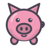</a> **Pig** Świnka `pig` · v4 · [raw](https://raw.githubusercontent.com/tobob/pastelki-assets/main/svg/zwierzeta/pig.svg) · [site](https://pastelki.club/en/image/pig) |
|  **Penguin on the ice** Pingwinek na lodzie `pingwinek-na-lodzie` · v7 · [raw](https://raw.githubusercontent.com/tobob/pastelki-assets/main/svg/zwierzeta/pingwinek-na-lodzie.svg) · [site](https://pastelki.club/en/image/pingwinek-na-lodzie) | <a href="../svg/zwierzeta/rabbit.svg">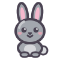</a> **Rabbit** Królik `rabbit` · v4 · [raw](https://raw.githubusercontent.com/tobob/pastelki-assets/main/svg/zwierzeta/rabbit.svg) · [site](https://pastelki.club/en/image/rabbit) | <a href="../svg/zwierzeta/sheep.svg">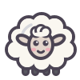</a> **Sheep** Owca `sheep` · v2 · [raw](https://raw.githubusercontent.com/tobob/pastelki-assets/main/svg/zwierzeta/sheep.svg) · [site](https://pastelki.club/en/image/sheep) |  **Elephant** Słoń `slon` · v1 · [raw](https://raw.githubusercontent.com/tobob/pastelki-assets/main/svg/zwierzeta/slon.svg) · [site](https://pastelki.club/en/image/slon) |
| <a href="../svg/zwierzeta/smoczek.svg">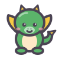</a> **Little dragon** Smoczek `smoczek` · v2 · [raw](https://raw.githubusercontent.com/tobob/pastelki-assets/main/svg/zwierzeta/smoczek.svg) · [site](https://pastelki.club/en/image/smoczek) | <a href="../svg/zwierzeta/snail.svg">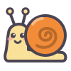</a> **Snail** Ślimak `snail` · v4 · [raw](https://raw.githubusercontent.com/tobob/pastelki-assets/main/svg/zwierzeta/snail.svg) · [site](https://pastelki.club/en/image/snail) | <a href="../svg/zwierzeta/sowa.svg">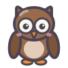</a> **Owl** Sowa `sowa` · v3 · [raw](https://raw.githubusercontent.com/tobob/pastelki-assets/main/svg/zwierzeta/sowa.svg) · [site](https://pastelki.club/en/image/sowa) | <a href="../svg/zwierzeta/squirrel.svg">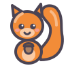</a> **Squirrel** Wiewiórka `squirrel` · v4 · [raw](https://raw.githubusercontent.com/tobob/pastelki-assets/main/svg/zwierzeta/squirrel.svg) · [site](https://pastelki.club/en/image/squirrel) |
| <a href="../svg/zwierzeta/turtle.svg">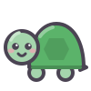</a> **Turtle** Żółw `turtle` · v4 · [raw](https://raw.githubusercontent.com/tobob/pastelki-assets/main/svg/zwierzeta/turtle.svg) · [site](https://pastelki.club/en/image/turtle) | <a href="../svg/zwierzeta/tygrys.svg">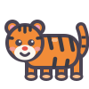</a> **Tiger** Tygrys `tygrys` · v1 · [raw](https://raw.githubusercontent.com/tobob/pastelki-assets/main/svg/zwierzeta/tygrys.svg) · [site](https://pastelki.club/en/image/tygrys) | <a href="../svg/zwierzeta/whale.svg">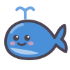</a> **Whale** Wieloryb `whale` · v4 · [raw](https://raw.githubusercontent.com/tobob/pastelki-assets/main/svg/zwierzeta/whale.svg) · [site](https://pastelki.club/en/image/whale) | <a href="../svg/zwierzeta/worm.svg">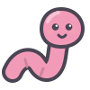</a> **Worm** Robaczek `worm` · v4 · [raw](https://raw.githubusercontent.com/tobob/pastelki-assets/main/svg/zwierzeta/worm.svg) · [site](https://pastelki.club/en/image/worm) |
| <a href="../svg/zwierzeta/zajac.svg">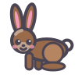</a> **Hare** Zając `zajac` · v3 · [raw](https://raw.githubusercontent.com/tobob/pastelki-assets/main/svg/zwierzeta/zajac.svg) · [site](https://pastelki.club/en/image/zajac) |  **Zebra** Zebra `zebra-2` · v1 · [raw](https://raw.githubusercontent.com/tobob/pastelki-assets/main/svg/zwierzeta/zebra-2.svg) · [site](https://pastelki.club/en/image/zebra-2) |  **Goldfish** Złota rybka `zlota-rybka` · v3 · [raw](https://raw.githubusercontent.com/tobob/pastelki-assets/main/svg/zwierzeta/zlota-rybka.svg) · [site](https://pastelki.club/en/image/zlota-rybka) |  **Giraffe** Żyrafa `zyrafa` · v2 · [raw](https://raw.githubusercontent.com/tobob/pastelki-assets/main/svg/zwierzeta/zyrafa.svg) · [site](https://pastelki.club/en/image/zyrafa) |
|  **Baby giraffe with a bow** Żyrafa maluch z kokardką `zyrafa-maluch-z-kokardka` · v5 · [raw](https://raw.githubusercontent.com/tobob/pastelki-assets/main/svg/zwierzeta/zyrafa-maluch-z-kokardka.svg) · [site](https://pastelki.club/en/image/zyrafa-maluch-z-kokardka) |  |  |  |
